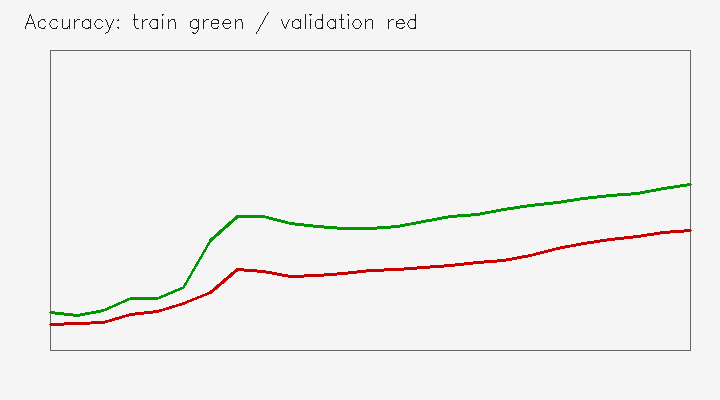
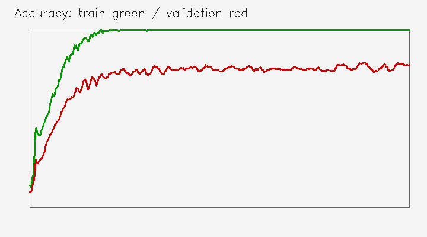
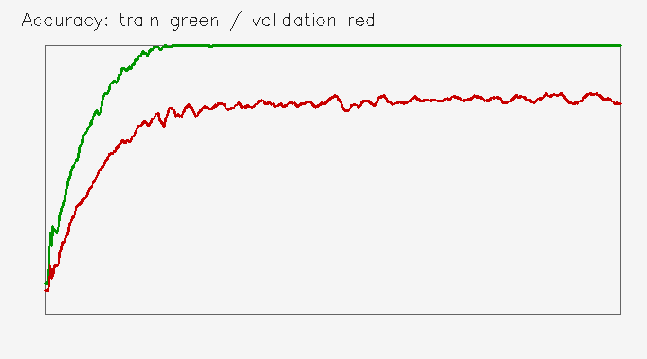

# 04 CPU 训练与小样本对照

网络约 5.1 万个参数，输出 0～9 和 negative 共 11 类。训练使用交叉熵与 Adam，batch size 为 128，学习率为 0.001。

| 位置 | 单张输入的输出形状 |
| --- | --- |
| 输入 | 1×1×32×32 |
| Conv + ReLU + MaxPool | 1×8×16×16 |
| Conv + ReLU + MaxPool | 1×16×8×8 |
| Flatten | 1×1024 |
| Linear + ReLU + Dropout | 1×48 |
| 最后 Linear | 1×11 |

## 先检查训练是否充分

复用第 02 节 grouped 完整训练结果，再从同一训练组抽取固定 128 张图。验证集始终为相同的 990 张图。

| 训练组 | 轮数 | 更新次数 | 末轮训练准确率 | 末轮验证准确率 |
| --- | --- | --- | --- | --- |
| 4950 张完整训练组 | 12 | 468 | 99.78% | 96.97% |
| 128 张小样本 | 25 | 25 | 55.47% | 40.10% |
| 128 张小样本长训练 | 468 | 468 | 100% | 80.10% |

最初 25 轮的两条曲线还在上升，训练集也没有充分拟合，不能只凭验证分数低就归为过拟合。

一轮 epoch 是遍历训练集一次，每个 batch 更新一次参数：4950 张图每轮有 `ceil(4950/128)=39` 次更新，12 轮共 468 次；128 张图每轮只有一次。将小样本组改为 468 轮，是从相同种子重新训练，前 25 轮日志与短训练一致。

## 长训练与增强

| 小样本长训练 | 最高验证准确率 | 最佳轮次 | 末轮验证准确率 | 末轮验证损失 |
| --- | --- | --- | --- | --- |
| 无额外增强 | 81.72% | 413 | 80.10% | 0.8373 |
| 额外亮度变化与平滑 | 82.12% | 408 | 78.48% | 1.1113 |

两组保持同样的 128 张训练图、验证集、468 次更新和学习率。绿色为训练准确率，红色为验证准确率：

训练后期都能拟合原始训练图，验证分数仍主要在约 80% 附近。额外增强的峰值只高约 0.40 个百分点，相当于验证集多对 4 张，末轮分数和损失更差；这次对照不足以证明明显改善。

这里的训练准确率在原始训练图上评价，不表示所有增强变体都识别正确。增强内容是亮度缩放与偶尔平滑，没有增加新字体来源。

## 权重选择

权重按**最高验证准确率**保存，同分保留较早一轮；这与最低验证损失是不同标准。后续评价、导出和部署使用增强组保存的**第 408 轮**，而不是最后一轮。参数记录为 `epochs=468, limit=128, augment=true`，种子为 731。

## 对应源码

[训练示例](src/main.py)；[共享实现](../_shared/core.py)中的 `TinyCNN`、`train()`、`layer_shapes()`。
