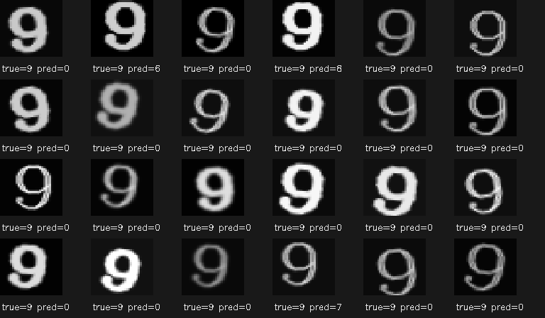

# 05 错例、混淆矩阵与输入变化

评价对象为第 04 节小样本增强模型保存的第 408 轮权重。固定验证集 990 张，原图准确率 **82.12%**，交叉熵损失 **0.9803**。

## 从一张错例到类别统计

先看到 `true=2, pred=8`，对局部形状的观察是“8 的笔画中包含 2”。弯曲笔画相似是一个检查方向，但单张错例不能确定网络实际依据了哪些特征。

混淆矩阵的行是真实类别，列是预测类别：

| 错误方向 | 张数 | 对应真实类别总数 |
| --- | --- | --- |
| 2 → 8 | 4 | 90 |
| 9 → 0 | 54 | 90 |
| 8 → 6 | 33 | 90 |

数字 9 只有 26/90 张识别正确，约 **28.89%**。整体准确率没有反映出各类差异。默认窗口只展示按数据顺序取出的前 24 张错例，主要是 2、3，不能据此推断最常见错误。

按真实类别筛选 9 后，看到尾巴弯曲、略模糊的外观。该类共错 64 张，其中 54 张被认成 0；这些观察作为待检验线索，未直接认定是网络出错原因。

## 同模型、同验证集的对照

模糊与变暗分别从原图开始，没有叠加：模糊使用 7×7、sigma=2 的高斯核，变暗将像素乘以 0.2。

| 输入条件 | 整体准确率 | 交叉熵损失 | 9 → 0 | 真实 9 识别正确 |
| --- | --- | --- | --- | --- |
| 原图 | 82.12% | 0.9803 | 54/90 | 26/90 |
| 额外模糊 | 80.81% | 0.8539 | 41/90 | 28/90 |
| 亮度乘以 0.2 | 33.23% | 4.5247 | 17/90 | 0/90 |

模糊后，“9→0”减少 13 张，真实 9 却只净增 2 张正确，其他错误去向总数从 10 增至 21，整体也少对 13 张。这里比较的是汇总数量，没有将其解释为逐张图片的转移路径。

准确率下降而损失下降可以同时发生：前者看真实类别是否排第一，交叉熵看分给真实类别的概率。

变暗后，900 张真实数字中 **613 张被预测为 negative**；数字 9 的 90 张全错，其中 73 张变为 negative、17 张为 0。negative 是训练过的负类，真实数字被判入负类属于误判，不能把“9→0”减少当作改善。

训练期额外亮度增强系数为 0.65～1.15，本次直接乘以 0.2，变化更大。这组模型明显不适应低亮度输入；使用增强并不表示已覆盖任意成像条件。

## 对应源码

[评价代码](src/main.py)使用 `--checkpoint` 指定权重、`--mode=blur/dark` 改变输入。`--class-id=9` 只筛选展示，指标仍基于完整评价集；混淆矩阵保存在本机结果目录。
