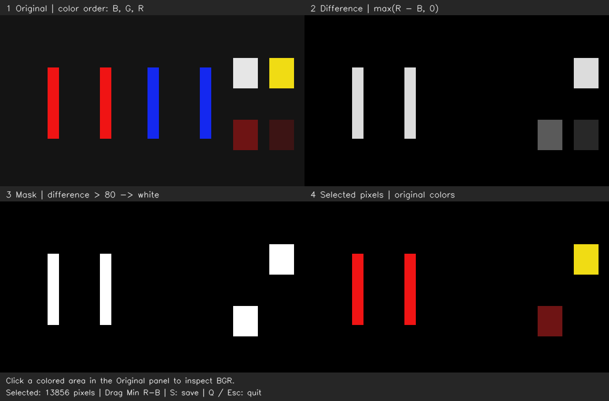
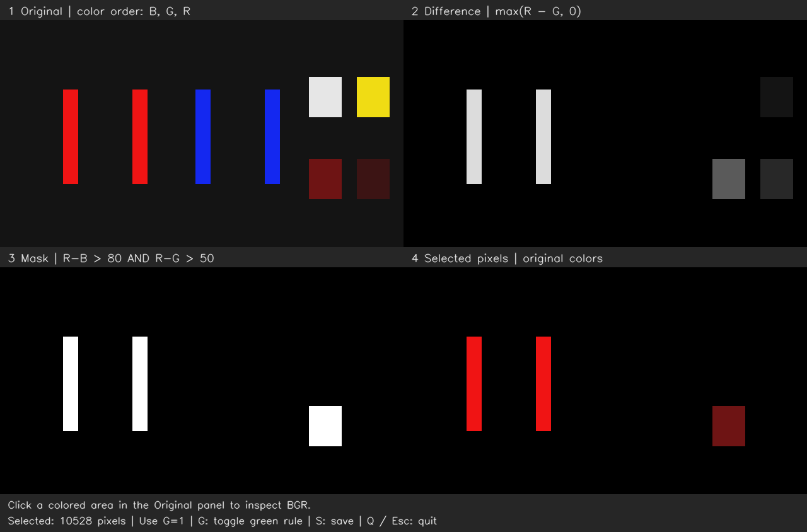

# OpenCV 01：图片、像素与颜色筛选

本课用 C++ 和 OpenCV 4，读取一张 640×360 的教学示意图，观察颜色数值，再用阈值选择像素。示意图由脚本生成，包含红、蓝灯条形状以及白色、黄色、不同亮度的红色块，不是真实比赛照片，也不代表已经完成装甲板检测。

## 实验记录

实验中将阈值从 80 调高，已观察到 mask 的白色区域变少，较暗的红色块消失。点击消失区域对应的原图位置，实际输出为：

```text
x=509 y=258  B=20 G=20 R=110  max(R-B, 0)=90
```

这个像素的 R-B 为 90。根据程序使用的严格“大于”规则，阈值小于 90 时选中；阈值等于或大于 90 时不选中。因此边界是“到 90 就消失”，不必等到超过 90。

黄色块也可能被选中，因为这条规则只比较 R 和 B，没有限制 G。示意图中的黄色块与亮红灯条具有相同的 R-B 差值，单独调这个阈值无法将二者区分。后面的颜色空间与形状筛选会继续处理这种问题。

随后固定 `Min R-B=80`、`Min R-G=50`，切换 `Use G`，确认黄色块被排除、暗红块仍保留；把 `Min R-G` 调到 90 后，暗红块也消失。两个 mask 取交集后，像素必须同时通过两个条件。

## 图片在程序里是什么

```cpp
const cv::Mat image = cv::imread(image_path, cv::IMREAD_COLOR);
```

`cv::Mat` 保存图像的像素数据。`image.cols` 是宽度，`image.rows` 是高度；本例读入三通道、每通道 8 位的彩色图片，每个通道的数值为 0～255。

OpenCV 以这里使用的 `IMREAD_COLOR` 方式读图时，通道顺序是 **B、G、R**，分别表示蓝、绿、红。图片坐标的原点在左上角，x 向右，y 向下，与海龟画面的世界坐标方向不同。

```cpp
const auto pixel = image.at<cv::Vec3b>(y, x);
// pixel[0] 是 B，pixel[1] 是 G，pixel[2] 是 R。
```

`at` 的参数按行、列排列，所以写 `(y, x)`。左键点击窗口左上方原图的颜色区域，可以在终端和窗口底部看到相应坐标与 BGR 数值。

## 用一条规则筛选像素

核心处理在 [filterRed](src/image_color.cpp) 中：

```cpp
cv::split(image, channels);
cv::subtract(channels[2], channels[0], result.red_minus_blue);
cv::threshold(result.red_minus_blue, result.mask_rb, threshold, 255,
              cv::THRESH_BINARY);
```

先比较红色通道与蓝色通道。在本例的 8 位无符号数据上，`subtract` 将负结果截为 0，得到 `max(R-B, 0)`。再与阈值 T 比较：

```text
R-B 大于 T → mask 为 255，显示为白色，选中这个像素
其他情况   → mask 为 0，显示为黑色，不选中这个像素
```

`mask` 是一张单通道的选择图，白色表示被选中，不表示原来的物体是白色。将它用于 `image.copyTo(result.selected, result.mask)` 后，可保留选中位置的原始颜色。

## 运行与观察

使用现有 Ubuntu 20.04 + ROS 1 Noetic 容器中的 OpenCV。这个程序直接处理图片，不需要启动 ROS master 或海龟。

在容器开发终端运行：

```bash
bash /home/rosdev/missing-semester/2027/Wit-1/self-study/opencv/01-image-color/run.sh
```

脚本自动构建并打开窗口。构建结果保存在 `~/catkin_ws/.opencv-build/01-image-color`，处理结果保存在 `~/catkin_ws/records/opencv/01-image-color`，均位于学习源码目录之外。

| 窗口区域 | 内容 |
| --- | --- |
| 左上 Original | 原始彩色图片 |
| 右上 Difference | `Use G=0` 显示 R-B 差值，`Use G=1` 显示 R-G 差值；值越大越亮 |
| 左下 Mask | 当前规则最终选出的区域，白色为选中 |
| 右下 Selected pixels | 选中区域的原始颜色，其余为黑色 |

下图是程序在阈值 80 时保存的四格输出，不包含窗口滑块：



交互操作：

- 拖动 `Min R-B` 滑块修改阈值，初始为 80，不需要重新编译。
- `Min R-G` 设置第二个阈值，初始为 50；`Use G (0/1)` 为 1 时，这个条件才参与最终筛选。
- 将 `Use G (0/1)` 设为 0 或 1，比较单条件与双条件；在图像窗口按 G 也可切换。
- 点击左上原图的颜色区域查看像素数值。
- 在图像窗口按 S，保存当前差值图、mask、筛选结果和四格总览。
- 按 Q、Esc 或关闭窗口退出；再次运行 `bash run.sh` 可以重新打开。

## 引入 G：让两个条件同时满足

已能解释：红、黄区域的 R-B 相同，单独调整这个阈值不能区分，需要引入 G。先采用一条直接的改进规则：

```text
R-B > 80，并且 R-G > 50
```

| 区域 | R-B | R-G | 双条件的预期结果 |
| --- | --- | --- | --- |
| 亮红灯条 | 220 | 220 | 保留 |
| 黄色块 | 220 | 20 | 排除 |
| 暗红块 `(B,G,R)=(20,20,110)` | 90 | 90 | 保留 |

程序分别生成两张二值 mask，再取交集：

```cpp
cv::subtract(channels[2], channels[1], result.red_minus_green);
cv::threshold(result.red_minus_green, result.mask_rg, green_threshold, 255,
              cv::THRESH_BINARY);
cv::bitwise_and(result.mask_rb, result.mask_rg, result.mask);
```

这里 mask 中的值只有 0 和 255，按位与的结果对应“两个条件都通过才选中”。`Use G=0` 时只使用 `mask_rb`，`Use G=1` 时使用交集。

在容器开发终端中，可直接打开双条件版本：

```bash
bash /home/rosdev/missing-semester/2027/Wit-1/self-study/opencv/01-image-color/run.sh --use-green
```

先固定 `Min R-B=80`、`Min R-G=50`，只切换 `Use G`。预期黄色块从最终 mask 中消失，暗红块仍被保留。再将 `Min R-G` 调到 90，暗红块应消失，因为 `90 > 90` 不成立。按上述步骤进行交互实验后，已确认筛选变化符合预期。

以下是 C++ 程序在双条件 `R-B>80`、`R-G>50` 下保存并自动检查的输出：



关闭练习窗口后会回到原来的容器终端；再次执行上面的命令即可重开窗口。若已进入本节目录，也可使用 `bash run.sh --use-green`。

本课先在这张可控示意图上理解规则与交集，之后用颜色空间和真实图像继续观察光照、曝光等因素的影响。

## 文件与检查

| 文件 | 用途 |
| --- | --- |
| `src/image_color.cpp` | 核心处理、像素查看和交互窗口 |
| `CMakeLists.txt` | 查找 OpenCV 并构建 C++ 程序 |
| `run.sh` | 自动编译、设置输入输出路径并运行 |
| `assets/color_scene.png` | 小型教学示意图 |
| `scripts/make_sample.py` | 用 Python 标准库重新生成示意图 |
| `scripts/check_lesson.py` | 在容器中调用实际 C++ 程序，检查颜色、阈值边界和输出 |

不打开窗口也可保存处理结果：

```bash
bash run.sh --headless --threshold=180
```

阈值使用严格“大于”比较。单条件模式的自动检查会验证：阈值升高时选中像素数量不增加，暗红区域会被排除，蓝色和白色被排除，黄色误选被保留，以及非法阈值被拒绝。

双条件检查另外覆盖：黄色在 R-G 阈值 20 时被排除，暗红在阈值 50 时保留、90 时排除，以及加入条件后不会产生单条件结果之外的像素。

2026-10-24 双条件版本已在同一容器中重新编译并通过检查：固定 R-B 阈值 80 时，R-G 阈值为 50 的选中像素数为 10528，亮红、暗红保留且黄色排除；R-G 阈值为 90 时选中数为 7200，暗红被排除。交互实验另外核对了筛选变化；上述精确像素数量来自程序自动检查。

2026-10-24 已在现有 Ubuntu 20.04 + ROS 1 Noetic 容器中完成 C++ 构建，实际 OpenCV 版本为 4.2.0。阈值 20、80、180、220、255 时，程序输出的选中像素数分别为 17184、13856、10528、0、0，颜色与输入检查通过；修正 GTK 窗口状态检查后，交互窗口已启动，并记录到滑块变化。这里区分程序检查结果与学习时对现象的解释。

## 参考

- [OpenCV 4.2 图片读写与 BGR 顺序](https://docs.opencv.org/4.2.0/d4/da8/group__imgcodecs.html)
- [二值阈值接口](https://docs.opencv.org/4.2.0/d7/d1b/group__imgproc__misc.html)
- [窗口、滑块和鼠标回调](https://docs.opencv.org/4.2.0/d7/dfc/group__highgui.html)
- [OpenCV 4.2 按位与及数组运算接口](https://github.com/opencv/opencv/blob/4.2.0/modules/core/include/opencv2/core.hpp)
