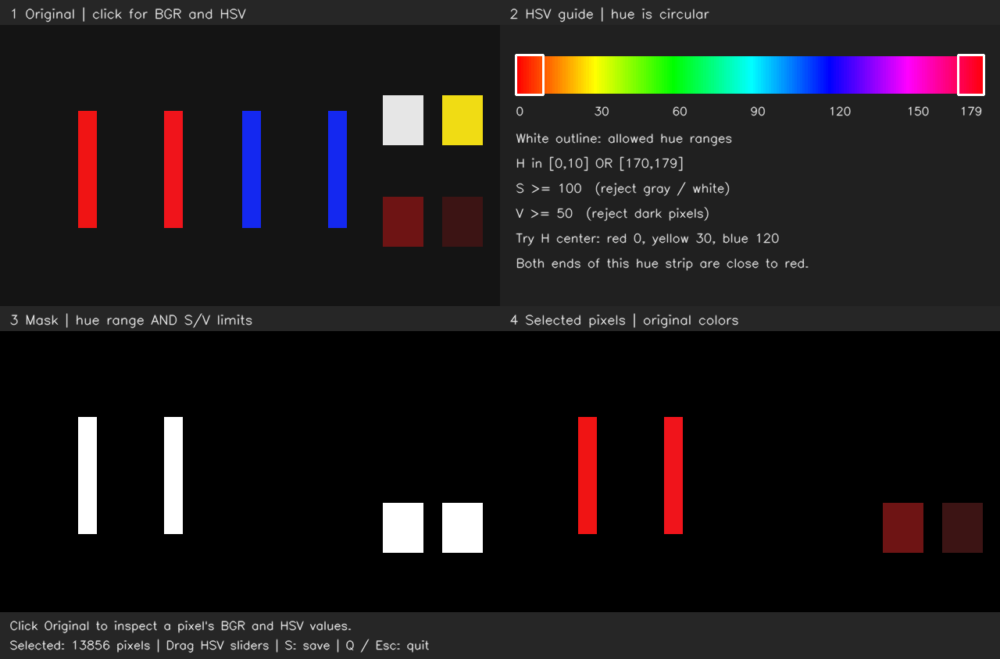

# OpenCV 02：HSV 与颜色范围

前一课用 R-B、R-G 两个差值区分示意图中的红色和黄色。本课把图片转换成 HSV，分别设置颜色、饱和度和明度条件。继续用现有 Ubuntu 20.04 + ROS 1 Noetic 容器中的 OpenCV 4.2.0，不需要 ROS master。

## 实验记录

本轮已经运行窗口并点击读取，实际结果为：

| 区域 | 像素坐标 | B、G、R | H、S、V |
| --- | --- | --- | --- |
| 亮红 | `(105,206)` | `(20,20,240)` | `(0,234,240)` |
| 较暗红块 | `(590,259)` | `(20,20,60)` | `(0,170,60)` |

两点的 H 都为 0，V 从 240 降为 60，与对明暗变化的判断一致；S 也从 234 降到 170，说明这两个具体像素的饱和度也不同。交互日志记录到 `V min=150` 时选中数为 7200，暗红区域被排除，只保留两条亮红灯条。精确数量来自程序日志，点击数值由实际交互读取并核对。

### 红色色相环绕与切换目标颜色

本轮在 `H center=0`、`H radius=0` 的步骤中，点击另一根红色灯条，实际输出为：

```text
x=213 y=204  B=27 G=20 R=240 | H=179 S=234 V=240
```

它的饱和度和明度仍较高，但 H=179 不在当前仅允许 H=0 的范围内，因此不能通过色相条件。结合前面 H=0 的红条，核对了色相首尾相邻的含义。恢复 `H radius=10` 时，程序通过两段范围的并集覆盖这两种红色。

之后保持 `H radius=10`、`S min=100`、`V min=50`，将 `H center` 改为 120，已确认筛选结果变成两根蓝色灯条。相同程序通过改变 H 范围切换目标颜色，S 和 V 继续限制饱和度与明度。

### 灰白像素的实际数值

本轮点击灰白块的实际输出为：

```text
x=520 y=130  B=230 G=230 R=230 | H=0 S=0 V=230
```

三个 BGR 分量相等，所以 S 为 0，像素没有明确的色相；这里编码的 H=0 不代表它是红色。V=230 只说明它较亮。`S min=0` 时，它能同时通过当前 H 和 V 条件；恢复饱和度下限 100 就可以将它排除。

交互日志记录到 `H=0 radius=10 S>=0 V>=50 selected=17184`，相比默认红色筛选的 13856 个像素，增加了灰白块对应的 3328 个像素。该数量来自程序日志，HSV 值来自点击查看。

## 同一个像素的另一种表示

| 通道 | 含义 | 本课 8 位数据的范围 |
| --- | --- | --- |
| H：色相 | 红、黄、蓝等颜色种类 | 0～179 |
| S：饱和度 | 颜色的浓淡，低值接近灰白 | 0～255 |
| V：明度 | 明暗程度 | 0～255 |

已经能判断：亮红色变成暗红色时，V 变化更明显，H 仍接近红色。HSV 方便分别设置条件，并不意味着实际曝光、光照变化不会影响颜色数值。

```cpp
cv::Mat hsv;
cv::cvtColor(image, hsv, cv::COLOR_BGR2HSV);
```

原始彩色图仍按 BGR 保存；转换后的 Mat 三个通道依次为 H、S、V。窗口点击原图时会同时打印这两组数值。

## 运行

在已有的容器开发终端运行：

```bash
bash /home/rosdev/missing-semester/2027/Wit-1/self-study/opencv/02-hsv/run.sh --verify
```

这条命令自动编译、运行检查并打开 HSV 窗口。之后重开窗口时不用重复检查：

```bash
bash /home/rosdev/missing-semester/2027/Wit-1/self-study/opencv/02-hsv/run.sh
```

构建产物保存在 `~/catkin_ws/.opencv-build/02-hsv`，运行记录与处理结果保存在 `~/catkin_ws/records/opencv/02-hsv`。`run.log` 包含本次编译、可选检查和交互输出。运行结果通过本机挂载保留，学习仓库只保存源码、教学输入图与选取的记录。

## 窗口与第一组实验

| 区域或滑块 | 作用 |
| --- | --- |
| 左上 Original | 点击颜色区域，查看 BGR 与 HSV |
| 右上 HSV guide | 显示色相参考条和当前筛选范围；白框表示允许的 H 范围 |
| 左下 Mask | 全部条件通过的位置为白色 |
| 右下 Selected pixels | 被选中的原始颜色 |
| H center / H radius | 色相中心与允许的偏差范围 |
| S min | 饱和度下限，初始为 100 |
| V min | 明度下限，初始为 50 |

先保持 `H center=0`、`H radius=10`、`S min=100`：

1. 点击左侧亮红灯条，再点击右下暗红色块，比较 HSV 数值。
2. 将 `V min` 从 50 调到 150，观察暗红区域是否消失、亮红灯条是否仍被保留。
3. 将 `V min` 调回 50，继续比较。

按 S 保存当前输出；按 Q、Esc 或关闭窗口退出。下图是默认参数下由 C++ 程序保存的四格输出，不包含滑块：



## 范围判断包含边界

核心筛选代码在 [hsv_filter.hpp](src/hsv_filter.hpp)。`cv::inRange` 要求同一个像素的 H、S、V 同时落在各自允许范围内，满足条件输出 255，否则输出 0。

```cpp
cv::inRange(hsv, cv::Scalar(h_low, s_min, v_min),
                 cv::Scalar(h_high, 255, 255), mask);
```

这里上下限都包含在内：`V min=110` 时，V=110 的像素仍保留；到 `V min=111` 才会被排除。这与上一课 `cv::threshold` 使用的严格“大于”条件不同，要按实际接口理解边界。

## 红色在 H 范围两端

色相是环形关系。H 接近 0 和接近 179 都可以是红色，不能将它们当作距离很远的两种颜色。本例默认围绕 H=0 取半径 10，形成两段允许范围：

```text
[0,10] 或 [170,179]
```

两段分别调用 `inRange`，然后用 `bitwise_or` 合并。它表示“满足其中一段即可”；每段内部的 H、S、V 条件仍需同时满足。

本课示意图单独生成，两个亮红灯条略有色差，用于覆盖 H 范围的两端。将 `H radius` 暂时调为 0，可以观察只取 H=0 是否漏掉另一根红条；将 `H center` 调到约 120 可以选择蓝色，调到约 30 可以选择黄色。

两段色相之间是“或”，与饱和度和明度限制之间仍是“并且”：

```text
(H 在 [0,10] 或 [170,179])，并且 S>=100，并且 V>=50
```

## 饱和度为什么有用

灰白像素的 S 很低，没有稳定、明确的色相。OpenCV 会给无彩色像素编码一个 H 值，因此只根据 H 选择红色，可能误选白色。保持红色范围，将 `S min` 从 100 调到 0，可以观察这种误选；实验后恢复 100。

## 文件与验证

| 文件 | 用途 |
| --- | --- |
| `src/hsv_filter.hpp` | 色相环绕范围与 HSV mask 的核心逻辑 |
| `src/main.cpp` | 读图、转换、滑块、像素查看与输出保存 |
| `run.sh` | 自动编译，按需检查，启动程序 |
| `assets/hsv_scene.png` | 包含亮暗红、蓝、黄、白的教学示意图 |
| `scripts/make_sample.py` | 用 Python 标准库生成输入图 |
| `scripts/check_lesson.py` | 检查实际 C++ 输出的色相环绕、明度边界、灰白排除及参数合法性 |

2026-10-24 已通过 `run.sh --verify` 在现有容器中构建并检查实际 C++ 程序，运行版本为 OpenCV 4.2.0。日志确认 `HSV CHECK PASSED`，检查覆盖 H=0/179 的红色环绕、灰白排除、V=110 的包含边界、蓝黄筛选和非法参数。窗口已启动，并完成上述像素查看与明度调整。

输出文件 `hue.png`、`saturation.png`、`value.png` 是三个通道数值的灰度表示，原色图和筛选结果分别查看 Original 与 Selected pixels。

## 参考

- [OpenCV 4.2 颜色空间转换与 HSV 范围](https://docs.opencv.org/4.2.0/df/d9d/tutorial_py_colorspaces.html)
- [HSV 转换公式与饱和度定义](https://docs.opencv.org/4.2.0/de/d25/imgproc_color_conversions.html)
- [inRange、bitwise_or 等数组接口及边界定义](https://github.com/opencv/opencv/blob/4.2.0/modules/core/include/opencv2/core.hpp)
