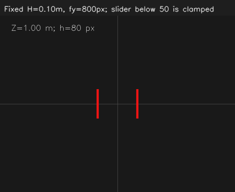

# OpenCV 06：相机成像、像素与深度

上一节得到两根灯条配对后的中心，接着开始考虑：像素坐标怎样与目标的实际位置联系起来？配对中心的单位是像素，还不能直接当成米制坐标。

## 学习记录

在“相机固定、不变焦、目标正对相机”的条件下，目标中心位置没变，灯条却越来越短，我判断是目标在远离。这里中心不动，只能说明目标仍沿着同一条视线，不能说明目标在空间中没有移动。

2026-10-24 已运行连续实验。这一节的例子把真实高度固定为 0.10 m、fy 固定为 800 px，通过滑块改变深度。

目前结合讨论弄清了下面的关系：

```text
h = fy × H / Z
Z = fy × H / h
```

H 是真实高度，单位米；h 是图像高度，单位像素；fy 是竖直方向的像素焦距，单位像素；Z 是沿相机前方光轴方向的深度，单位米。

讨论中还换了一个条件：真实高度和深度都不变，只把 fy 从 800 改成 1600。我算出图像高度会从 80 px 变成 160 px。图中尺寸变大也可能来自相机成像参数变化，比较远近时要留意哪些条件保持不变。这是对公式的对照，当前窗口只有深度滑块。

### 深度滑块的实际观察

把 `Depth cm` 分别调到 100 和 200，读到：

| Depth cm | 深度 Z | 窗口中的高度 h |
| --- | --- | --- |
| 100 | 1 m | 80 px |
| 200 | 2 m | 40 px |

我的观察是：“80px，40px，间距变小。”深度从 1 m 增加到 2 m，像素高度变成一半；两根红条的像素间距也缩小了。

结合代码看，灯条的真实高度和真实间距都保持不变，变化来自投影。高度使用 `fy * H / Z`，两根中心的像素间距使用 `fx * W / Z`，因此在相机参数和目标姿态固定时，两者都随深度增大而缩小。本例中的间距 W 为 0.135 m：

```cpp
const int spacing = cvRound(800 * 0.135 / depth / 2);
```

`spacing` 是每根红条中心到画面中央的水平像素距离，左右两根的中心间距是 `2 * spacing`。这里随深度缩小的是图中的像素间距，物体实际的两根灯条并没有靠拢。

## 本节窗口怎么操作

在已有的容器终端单独打开，不需要相机：

```bash
bash /home/rosdev/missing-semester/2027/Wit-1/self-study/opencv/06-camera-model/run.sh
```

滑块 `Depth cm` 以厘米表示深度，100 为 1 m，200 为 2 m。画面左上方的 `Z` 是深度，`h` 是程序按成像公式算出的灯条像素高度。先固定相机参数，调深度，再把这些数值和红条大小、两根红条的间距一起对照。

滑块低于 50 时按 50 处理，避免距离为零。按 S 保存当前结果，按 Q 退出窗口。

源码：[src/main.cpp](src/main.cpp)。这一段控制图像高度：

```cpp
const double depth = std::max(50, value) / 100.0;
const double height = 800 * 0.1 / depth;
```

第一行把滑块的厘米转成米，第二行计算像素高度。这里是模拟成像，`Z` 来自滑块，`h` 由程序计算；以后处理相机图像时，才是从检测结果中测量像素尺寸。

结果位于 `~/catkin_ws/records/opencv/offline-course/06-camera-model`。默认 1 m 时的程序输出如下：



<details>
<summary>后续实验用到的公式与参数</summary>

### 内参矩阵 K

在 OpenCV 相机坐标约定中，X 向右、Y 向下、Z 向相机前方。暂时忽略畸变：

```text
u = fx * X / Z + cx
v = fy * Y / Z + cy

K = [ fx   0   cx ]
    [  0  fy   cy ]
    [  0   0    1 ]
```

fx、fy 表示空间方向比值如何变成像素偏移，cx、cy 表示主点位置。它们一起称为相机内参。cx、cy 通常在图像中心附近，但实际值需要标定，不能直接把图像中心当作测量结果。

本套离线相机实验统一使用 640×480、fx=fy=800、cx=320、cy=240。前面的 640×360 交互示意图使用的是当时单独设定的模型，阅读参数时应与对应图像一致。

知道 Z 后，可以把某个像素反算为相机坐标：

```text
X = (u-cx) * Z / fx
Y = (v-cy) * Z / fy
```

例如像素 (400,200)、深度 2 m，在本节模拟参数下得到 X=0.2 m、Y=-0.1 m、Z=2 m。Y 为负表示位于光轴上方。若只有这个像素、没有 Z，得到的是一条视线方向，而不是唯一三维点。

fy 需要通过相机标定获取，不是直接以毫米表示的镜头焦距。只知道中心像素或灯条像素高度，而不知道实际尺寸和相机参数，不能直接求出米制深度。

`Z` 是沿光轴的深度；`sqrt(X²+Y²+Z²)` 是空间点到相机原点的直线距离。

### 图像尺寸变化后怎样处理 K

如果坐标缩放关系为 `u'=sx*u`、`v'=sy*v`，则 fx、cx 乘 sx，fy、cy 乘 sy。若从原图裁掉左上偏移 (x0,y0) 的 ROI，则对应主点变为 `(cx-x0, cy-y0)`。先裁剪再缩放时按操作顺序更新。

把图像裁剪、缩放或去畸变后，后续计算要使用对应坐标和参数。不能让某张小 ROI 的像素位置直接配上原始整张图的内参。

完整空间解算还涉及畸变、已知物体的三维尺寸、图像特征点以及目标姿态。本节尺寸公式用于理想正对情形，不能直接替代一般姿态下的求解。

这里的尺寸和内参是模拟参数。真实相机要使用自己的标定结果和物体尺寸。

参考：[OpenCV 相机成像与标定模型](https://docs.opencv.org/4.2.0/d9/d0c/group__calib3d.html)。

</details>
