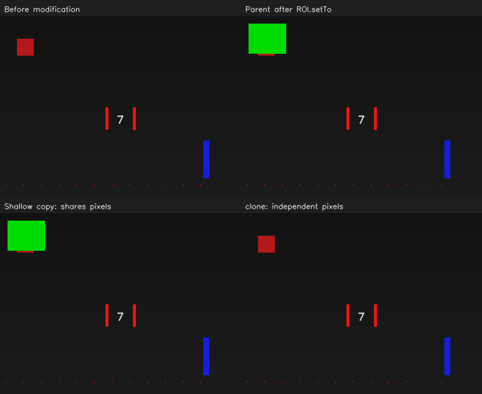

# OpenCV 07：Mat、拷贝与 ROI

从相机模型转到图像处理中的数据共享。这次通过给一块区域涂绿，观察原图、浅拷贝和独立拷贝之间的关系。

## 实验记录

2026-10-24 运行窗口后，我观察到：“修改后和浅拷贝出现绿色区域，另外两个保持原样。”

| 窗口面板 | 实际观察 |
| --- | --- |
| Before modification：修改前的图 | 保持原样 |
| Parent after ROI.setTo：修改后的原图 | 左上矩形区域变绿 |
| Shallow copy：浅拷贝 | 同一个区域也变绿 |
| clone：独立拷贝 | 保持原样 |

程序只对 ROI 执行一次 `setTo`，却影响了原图和浅拷贝。结合代码看，原因是它们共享同一份像素；修改前保存的图和 `clone` 拷贝有各自独立的像素，所以没有跟着变化。

## 对照代码理解

本次使用的关键代码位于 [src/main.cpp](src/main.cpp)：

```cpp
const auto before = image.clone();
cv::Mat shallow = image;
cv::Mat deep = image.clone();
cv::Mat roi = image(cv::Rect(20, 20, 100, 80));
roi.setTo(cv::Scalar(0, 220, 0));
```

`cv::Mat` 用来表示图像，包含尺寸、类型、数据地址等描述信息。`shallow = image` 复制这些描述信息，并与原图共享像素；`image.clone()` 会另外复制像素。`before` 和 `deep` 都在涂绿之前做了 `clone()`，因此保留了当时的图像。

`image(cv::Rect(20, 20, 100, 80))` 取出左上角为 `(20,20)`、宽 100、高 80 的矩形区域。这个 ROI 是原图一部分像素的视图；给它涂色会改到原图，浅拷贝也会看到同样的变化。

实际处理时，如果希望在检测结果图上画框，同时保留输入原图，可以先 `clone()` 一份再画。若希望独立修改裁剪出来的区域，可以这样写：

```cpp
cv::Mat roi_copy = image(rectangle).clone();
```

## 重新运行

在容器开发终端中运行：

```bash
bash /home/rosdev/missing-semester/2027/Wit-1/self-study/opencv/07-mat-roi/run.sh
```

按 Q 退出，按 S 保存当前结果。运行结果位于 `~/catkin_ws/records/opencv/offline-course/07-mat-roi`。



<details>
<summary>Mat 类型、步长与相关接口备查</summary>

### 常用类型与访问方式

| 写法 | 意义 |
| --- | --- |
| `image.rows` / `image.cols` | 行数即高度 / 列数即宽度 |
| `CV_8UC1` | 每个通道为 8 位无符号数，单通道，常用于灰度或 mask |
| `CV_8UC3` | 同样的数值类型，三个通道，普通彩色图常按 BGR 排列 |
| `CV_32F` / `CV_64F` | 单精度 / 双精度浮点数，常用于计算矩阵 |
| `image.at<cv::Vec3b>(y, x)` | 访问三通道 8 位图的一个像素 |

`channels()` 表示通道数量，`depth()` 表示单个通道的数值类型；这里的 depth 与相机测距的深度 Z 是不同概念。

`imread` 后先检查 `empty()`。读取普通彩色图时明确使用 `cv::IMREAD_COLOR`，不能仅凭文件后缀就假定通道数。后续处理函数也有输入类型要求，例如本课程的 Canny 输入是 8 位灰度图。

ROI 的范围不能越过原图边界。

`copyTo` 可以复制到已有目标，带 mask 时只复制指定区域。`convertTo` 用于数值类型与线性缩放，`cvtColor` 用于颜色表示转换，二者用途不同。

### ROI 与步长

ROI 不一定连续，不能总按 `rows * cols * channels` 推断数据的实际跨行布局。需要自己遍历时，优先按行用 `ptr<T>(y)`，或使用 OpenCV 函数处理。这也解释了 ROS 图像消息为什么有 `step` 字段。

本例 ROI 的每行仍使用原图步长。`metrics.json` 中 `roi_continuous` 为 0，`shallow_shares_data` 为 1，`clone_independent` 为 1。接收 `cv_bridge` 共享图像时也要考虑像素所有权和生命周期；共享图像适合只读，需要画框时先 `clone()`。

参考：[OpenCV 4.2 Mat 接口](https://docs.opencv.org/4.2.0/d3/d63/classcv_1_1Mat.html)。

</details>
