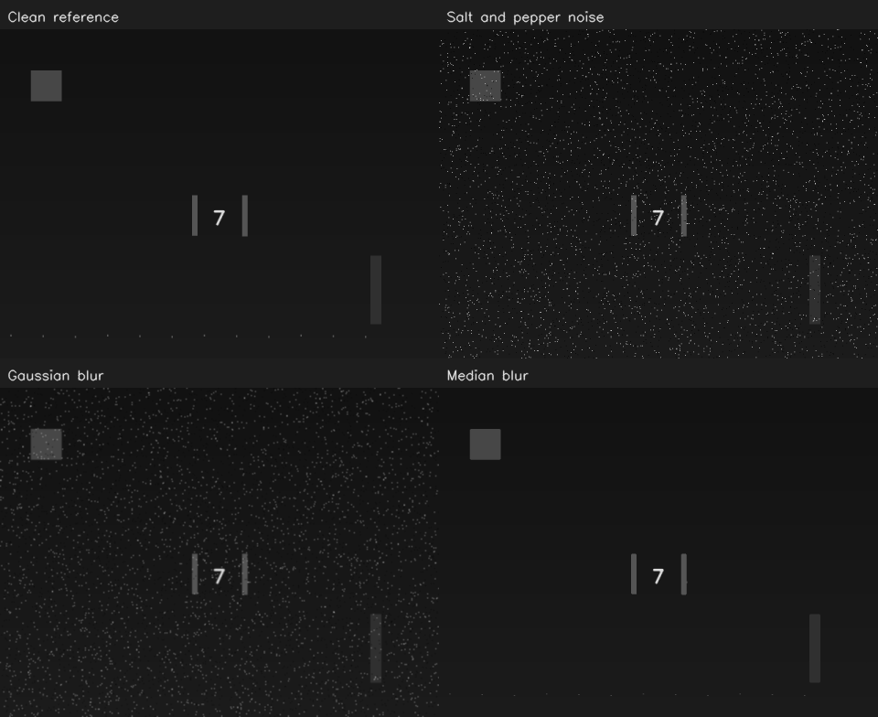
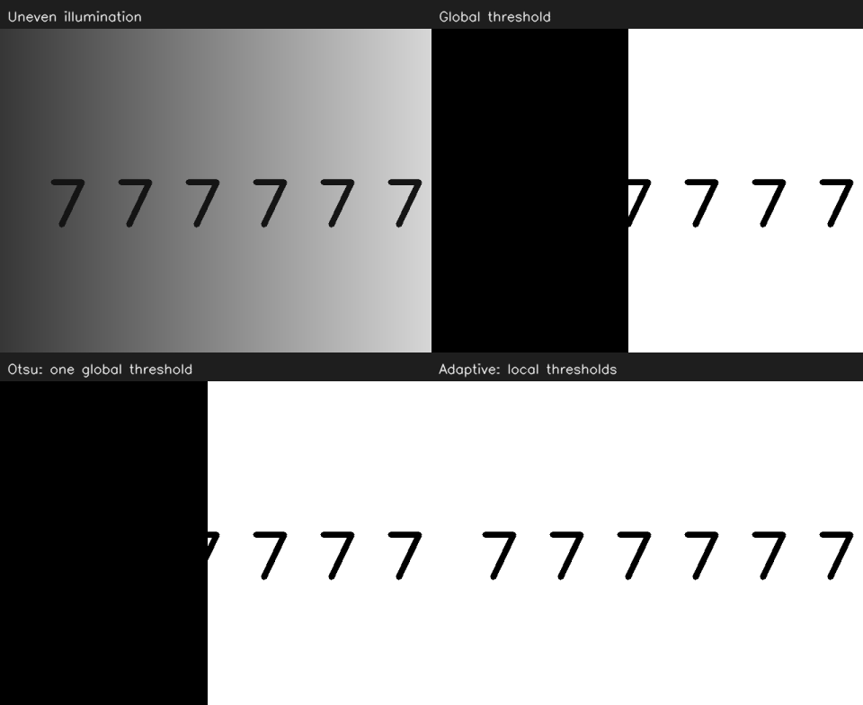
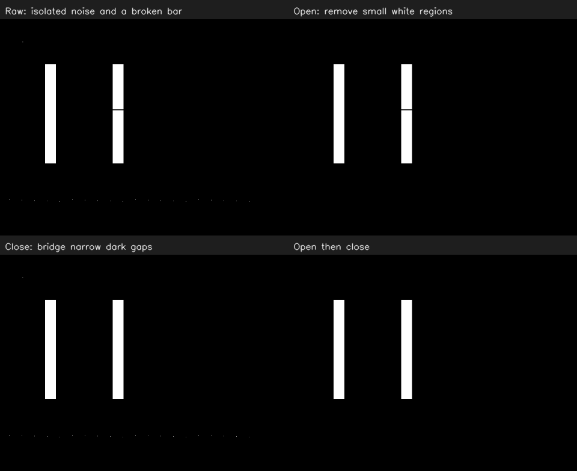

# OpenCV 08：滤波、阈值与形态学

前面的颜色筛选使用干净示意图。本节加入孤立噪声、断开的灯条和不均匀光照，学习几类预处理各自改变了什么。

## 滤波实验记录

2026-10-24 在 `08 Filters` 窗口中，对比高斯滤波和中值滤波，并按步骤把 `Kernel radius` 从 1 调到 3。滑块对应的实际核从 3×3 变成 7×7。

我的反馈是：“中值滤波去除黑白小点更干净，高斯滤波保留灯条边缘以及数字更清楚。”

这次把两个观察分开记录：中值图的椒盐噪点去得更干净；对比细节时，我觉得高斯图中的灯条边缘和数字更容易辨认。后者是本图和本次参数调整下的视觉感受，比较时还要对照左上角的 `Clean reference`，看原来的笔画、宽度和形状有没有丢失。

结合代码理解，中值滤波用邻域像素的中位数替换当前像素，孤立黑白点通常会被周围正常像素压下去。核过大时，细笔画或细灯条在邻域中也可能只占少数，因而被抹掉。高斯滤波按邻域加权平均，会平滑噪声，也会模糊边缘。“噪点少”和“目标细节保留得好”需要分别比较。

### 把中值滤波的核继续调大

随后把 `Kernel radius` 调到 7，对应 15×15 核，重点观察右下角中值滤波图，再调回 1（3×3 核）。我的反馈是：“数字7消失，灯条边缘会缩小，调回1会恢复。”

这次直接看到，核过大时，被去掉的不只有噪点，数字笔画和灯条形状也会受影响。滤波取中位数时只处理邻域里的像素值，没有关于“这是数字、应该保留”的判断。因此选择核大小时，也要检查后续要检测的细节是否完整。

调回 1 后，程序重新用小核处理同一张原始加噪图，细节因此重新出现。代码中每次滑块变化都执行 `cv::medianBlur(noisy, median, size)`，输入始终是 `noisy`。

## 全局阈值实验记录

接着打开 `08 Thresholds`，左上原图的背景左暗右亮，数字为黑色。把 `Global threshold` 分别调到 80 和 180，观察右上角全局阈值结果。我的反馈是：“黑色背景向右边扩大，数字7与黑色背景融合。”

这段代码对整张图使用同一个门槛：

```cpp
cv::threshold(gray, global, value, 255, cv::THRESH_BINARY);
```

规则是灰度大于阈值变成白色，其余变成黑色。提高阈值后，更多背景像素也会被分成黑色；背景从左到右逐渐变亮，因此黑色区域向右扩大。数字原本也被分成黑色，在这些区域便与背景连成一片。

例如一个灰度为 100 的背景像素，阈值为 80 时输出白色，阈值为 180 时输出黑色。这里是当前阈值下的分类结果；看到黑色区域，还需要分辨它来自数字还是背景。

### 对照右下角的自适应阈值

保持全局阈值为 180，观察右下角 `Adaptive`：左侧较暗区域的数字仍然能完整看清。接着拖动 `Global threshold` 滑块，右下图没有跟着变化。

结合代码看，自适应阈值使用每个位置周围的亮度估计局部门槛。本例使用 31×31 邻域的高斯加权平均，再减去常数 7，作为该位置的阈值：

```cpp
cv::adaptiveThreshold(gray, adaptive, 255,
    cv::ADAPTIVE_THRESH_GAUSSIAN_C, cv::THRESH_BINARY, 31, 7);
```

这次暗处数字能够与背景分开，是本图在这些参数下的实际效果。右下图不随滑块变化的原因也能从代码找到：滑块的 `value` 只传给右上角的全局阈值处理，自适应阈值的 31 和 7 在程序中固定。因此自适应阈值也有需要选择的参数。

窗口中三种处理分别是：右上手动指定全图统一门槛；左下 Otsu 根据整张图的灰度分布自动选一个统一门槛；右下自适应阈值按局部亮度计算门槛。Otsu 的自动选值和自适应阈值的局部计算是两种不同机制。

## 形态学实验记录

进入 `08 Morphology`，输入为白色灯条、白色孤立噪点和黑色背景组成的 mask，右侧灯条中间有一条黑色断口。把 `Kernel radius` 从 0 调到 1，即从 1×1 核改成 3×3 核，对照结果：

| 面板 | 实际观察 |
| --- | --- |
| 右上 Open：开运算 | 去掉了小白点 |
| 左下 Close：闭运算 | 补上了灯条断口 |

结合这张图理解，腐蚀让白色区域收缩，膨胀让白色区域扩张。开运算先腐蚀、后膨胀：小白点在腐蚀时消失，后续膨胀让保留下来的较大白色区域扩张，小白点不会因此长回来。闭运算先膨胀、后腐蚀：先把窄黑缝两侧的白色区域连起来，再让外轮廓大致缩回，所以本例的灯条断口被补上。

对应代码分别为：

```cpp
cv::morphologyEx(raw, opened, cv::MORPH_OPEN, kernel);
cv::morphologyEx(raw, closed_mask, cv::MORPH_CLOSE, kernel);
```

### 大核也会清掉灯条

把 `Kernel radius` 从 1 调到 16，核从 3×3 变成 33×33。观察右上 `Open` 和右下 `Open then close`，两根灯条都没能保留下来。

源码生成的灯条宽度为 24 px，33×33 核比灯条还宽。开运算第一步腐蚀时，白色区域已经无法容纳这个核，灯条便被清掉；后续膨胀或闭运算也无法从空白区域重新生成它们。

这次与前面的中值滤波大核实验联系起来：参数调大时，不仅噪点会减少，需要检测的真实目标也可能消失。检查预处理效果时，要同时看噪声、目标是否保留，以及边界有没有变化。

## 三组实验

在容器终端中：

```bash
cd ~/missing-semester/2027/Wit-1/self-study/opencv/08-preprocess
bash run.sh --variant=blur
bash run.sh --variant=threshold
bash run.sh --variant=morph
```

每组按 Q 退出后再运行下一组；一口气运行全部课程时，脚本会自动按这个顺序打开。源码在 [src/main.cpp](src/main.cpp)。

## 滤波：先处理像素波动

本例给灰度图加入随机黑白点，比较原图、高斯滤波和中值滤波。

```cpp
cv::GaussianBlur(noisy, gaussian, cv::Size(size, size), 0);
cv::medianBlur(noisy, median, size);
```

高斯滤波按邻域加权平滑，中值滤波取邻域的中间数值。本例的椒盐噪声适合用中值滤波演示；这不意味着中值滤波在所有图像上都更好。核越大，处理影响的邻域越大，也可能抹掉细小结构。

滑块为半径 `r`，实际核大小为 `2*r+1`。例如 1 表示 3×3，3 表示 7×7。半径为 0 时本例保留原图，不执行中值滤波。

程序的自动检查比较本例中值结果与干净原图的差值是否比加噪后更小。实际调参还要看数字笔画与灯条形状，不能只用整图差值判断细小目标是否完整。

下面是程序在 3×3 核时保存的对照图，方便回看四个面板：



<details>
<summary>阈值与形态学的接口、示例图与说明</summary>

## 阈值：按亮度分前景

这一组使用带光照梯度的灰度图：

```cpp
cv::threshold(gray, global, value, 255, cv::THRESH_BINARY);
cv::threshold(gray, otsu, 0, 255, cv::THRESH_BINARY | cv::THRESH_OTSU);
cv::adaptiveThreshold(gray, adaptive, 255,
    cv::ADAPTIVE_THRESH_GAUSSIAN_C, cv::THRESH_BINARY, 31, 7);
```

| 方法 | 规则 | 阅读重点 |
| --- | --- | --- |
| 全局阈值 | 整张图使用同一个门槛 | 本例滑块只控制它 |
| Otsu | 根据整张图灰度分布选一个全局门槛 | 它不知道“灯条”或“数字”是什么 |
| 自适应阈值 | 按局部邻域计算门槛 | 31 为局部窗口大小，7 为减去的常数 |

观察全局阈值从低到高时，亮背景和暗背景如何影响结果。Otsu 仍然只有一个全局值；光照不均时，局部方法可能更合适。阈值方向也要与前景定义对应，本例用白背景、黑数字，不能把任何白色区域都当成目标。

灰度阈值判断明暗；HSV 判断颜色范围。二者可以组合，但不能互相替代。红色像素变暗后，其灰度未必比亮白背景高。



## 形态学：再处理 mask 的形状

输入是二值 mask，白色为前景。基本操作如下：

| 操作 | 顺序或作用 | 可能带来的问题 |
| --- | --- | --- |
| 腐蚀 `erode` | 收缩白色区域 | 细灯条可能消失 |
| 膨胀 `dilate` | 扩张白色区域 | 邻近目标可能黏连 |
| 开运算 `MORPH_OPEN` | 先腐蚀、后膨胀 | 去小白噪声，也可能删掉小目标 |
| 闭运算 `MORPH_CLOSE` | 先膨胀、后腐蚀 | 填小黑缝，也可能连接不该连接的区域 |

```cpp
auto kernel = cv::getStructuringElement(cv::MORPH_RECT, cv::Size(3, 3));
cv::morphologyEx(mask, opened, cv::MORPH_OPEN, kernel);
cv::morphologyEx(mask, closed, cv::MORPH_CLOSE, kernel);
```

本例右侧灯条有两像素高的断口，另有一些孤立白点。依次观察：

1. 半径 0：1×1 核基本不改变 mask，噪点和断口保留。
2. 半径 1：开运算移除小白点，闭运算补上本例的窄断口；先开后闭可得到两根完整条。
3. 半径 16：33×33 核比灯条还宽，开运算会把灯条也清掉。去噪不能只追求画面“干净”。



## 实验结果如何核对

结果目录为 `~/catkin_ws/records/opencv/offline-course/08-preprocess`，显式指定 `--variant` 时分别存入 `blur/`、`threshold/` 或 `morph/` 子目录。再次运行同一组会更新该组当前快照；批量验证按实验分开保存。

在默认 3×3 形态学实验中，`noise_after_open` 应为 0，`gap_after_close` 应为 255，`cleaned_components` 应为 2。这里的连通区域个数不同于所有层级轮廓数量。

调参顺序建议是：先看原图，再看颜色 mask，最后决定是否需要形态学；每次只改一个条件。形态学后的边界可能移动，后续几何测量和 PnP 也会受影响。

</details>

参考：[滤波](https://docs.opencv.org/4.2.0/d4/d13/tutorial_py_filtering.html)、[阈值](https://docs.opencv.org/4.2.0/d7/d4d/tutorial_py_thresholding.html)、[形态学](https://docs.opencv.org/4.2.0/d9/d61/tutorial_py_morphological_ops.html)。
