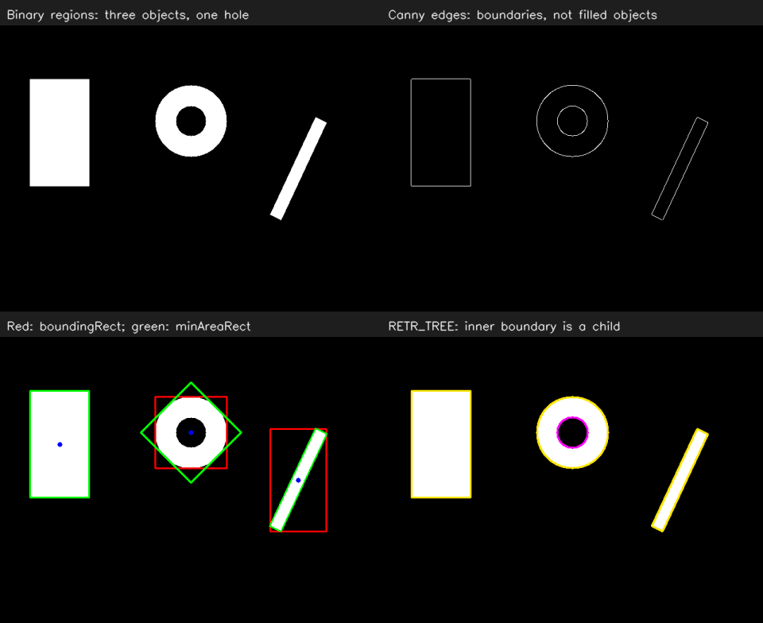

# OpenCV 09：边缘、轮廓层次与几何测量

上一节处理 mask 中的噪点和断口，这一节继续看怎样从 mask 中提取边界，再用几何形状描述它。实验图包含一个矩形、一个带孔圆环和一根倾斜条。

## 实验记录

2026-10-31 在右下角 `RETR_TREE` 面板观察圆环，我看到两圈彩色轮廓线，分别沿着内环和外环。外侧轮廓围住圆环外边缘，内侧轮廓围住中间的黑色孔洞。

结合这个观察，圆环虽然是一个独立的白色连通区域，却有外侧和内侧两条边界。因此轮廓数量不能直接当作目标数量。

对照程序保存的 `metrics.json`：

| 检索方式或统计 | 本例程序输出 | 对应含义 |
| --- | --- | --- |
| `RETR_EXTERNAL` | 3 个轮廓 | 矩形、圆环和倾斜条各保留一个外轮廓 |
| `RETR_TREE` | 4 个轮廓 | 另外保留圆环内部孔洞的边界 |
| `child_contours` | 1 个 | 本例圆环内孔边界是外轮廓的子轮廓 |

所以两种检索方式的计数差异来自保留边界的规则，图中的独立目标并没有增加。

### 倾斜灯条的红绿框对比

接着看左下面板中倾斜的灯条，实际观察到：绿框贴合灯条方向，红框包进了更多黑色背景。

| 框的颜色 | 对应接口 | 结合本次观察理解 |
| --- | --- | --- |
| 绿色 | `cv::minAreaRect` | 矩形可以旋转，长边沿着灯条方向，更贴近灯条 |
| 红色 | `cv::boundingRect` | 边始终沿图像横纵轴，包住倾斜灯条时带入更多背景 |

对应两行代码：

```cpp
cv::Rect upright = cv::boundingRect(contour);
cv::RotatedRect rotated = cv::minAreaRect(contour);
```

这也解释了前面筛选灯条时为什么用旋转外接矩形的长短边比。灯条在图中转动后，水平包围框的宽高会明显变化；旋转矩形能跟随条的方向，更适合描述图中的细长形状。这里得到的长短边仍然以像素为单位。

### 原始 mask 与 Canny 的对照

继续比较左上原始 mask 和右上 Canny 中的矩形：原始 mask 内部为整块白色，Canny 图中只剩边界细线。

结合代码区分两个接口：`Canny` 输出一张边缘图；`findContours` 提取一组轮廓，每个轮廓由边界点组成，后续才能对这些点计算面积和外接矩形。本例分别从同一张 `mask` 做处理：

```cpp
cv::Canny(mask, edges, 60, 120);
cv::findContours(mask, outer, cv::RETR_EXTERNAL, cv::CHAIN_APPROX_SIMPLE);
```

因此本例提取轮廓直接使用填充区域的 mask，Canny 结果用于对照显示。颜色筛选已经得到合适的二值区域时，可以直接从该区域提取轮廓。

## 运行

```bash
bash /home/rosdev/missing-semester/2027/Wit-1/self-study/opencv/09-contour-geometry/run.sh
```

源码：[src/main.cpp](src/main.cpp)。窗口中红框是水平外接矩形，绿框是旋转外接矩形，蓝点是轮廓矩计算的中心。

<details>
<summary>轮廓检索与几何接口备查</summary>

## Canny 与 findContours 的分工

```cpp
cv::Canny(gray, edges, 60, 120);
cv::findContours(mask, contours, cv::RETR_EXTERNAL, cv::CHAIN_APPROX_SIMPLE);
```

Canny 根据亮度变化寻找边缘，结果通常是一圈细线。`findContours` 从二值图中提取边界点集合。颜色检测常先得到白色实心区域，再提取轮廓；不是每条视觉流程都必须先用 Canny。

将同一物体的双侧边缘分别提取出来，可能得到多个轮廓，所以“轮廓数”不天然等于“物体数”。本课程的几何计数从填充的 mask 读取，Canny 只作对照显示。

## 外轮廓与内孔

| 模式 | 保留内容 | 本例程序输出 |
| --- | --- | --- |
| `RETR_EXTERNAL` | 只保留最外层边界 | 3 个 |
| `RETR_TREE` | 保留边界及完整嵌套关系 | 4 个，圆环多出内孔边界 |

`hierarchy[i]` 的四项分别是同层下一个、同层上一个、第一个子轮廓、父轮廓的编号；不存在时为 -1。本例内孔的父编号不为 -1。

对带孔区域，只计算外轮廓的 `contourArea` 不会自动扣去内孔。需要根据层级计算净面积，或另行统计 mask 白像素；后者与几何轮廓面积又不完全相同。

## 两种外接矩形

```cpp
cv::Rect upright = cv::boundingRect(contour);
cv::RotatedRect rotated = cv::minAreaRect(contour);
```

水平矩形的边固定沿图像 x/y 方向。条形目标倾斜后，它的水平包围框可能变得很宽，因此不适合直接用来判断实际细长程度。旋转矩形可以随目标方向变化，之前的灯条筛选使用的是它的长边与短边。

`minAreaRect` 给出的是包围几何形状，并不自动给出物体的真实姿态。`RotatedRect::angle` 还与矩形边的选择有关；本课程自己从长边向量计算方向，避免把这个原始角度直接当作统一倾角。

## 中心与退化情况

轮廓矩可以给出区域中心：

```cpp
auto m = cv::moments(contour);
if (std::abs(m.m00) > 1e-9) {
    double center_x = m.m10 / m.m00;
    double center_y = m.m01 / m.m00;
}
```

单点、线段等退化轮廓可能面积为 0，要避免直接相除。矩形中心、轮廓矩中心和两根灯条的中点也不是同一个定义，在不对称形状下可能不同。

## 实验与解释

观察倾斜条上的红、绿框：绿框能贴近条的方向，红框始终水平。观察圆环：外轮廓模式只保留外圈，树模式还记录内圈；这多出来的边界不代表多了一个独立目标。

运行结果位于 `~/catkin_ws/records/opencv/offline-course/09-contour-geometry`。`external_contours=3`、`tree_contours=4`、`child_contours=1` 可用于核对本例。真实画面中的结果则取决于输入 mask。

参考：[OpenCV 4.2 轮廓与形状接口](https://docs.opencv.org/4.2.0/d3/dc0/group__imgproc__shape.html)。

</details>

## 程序结果图

四个面板依次是二值区域、Canny 边缘、两种外接矩形和轮廓层次。


