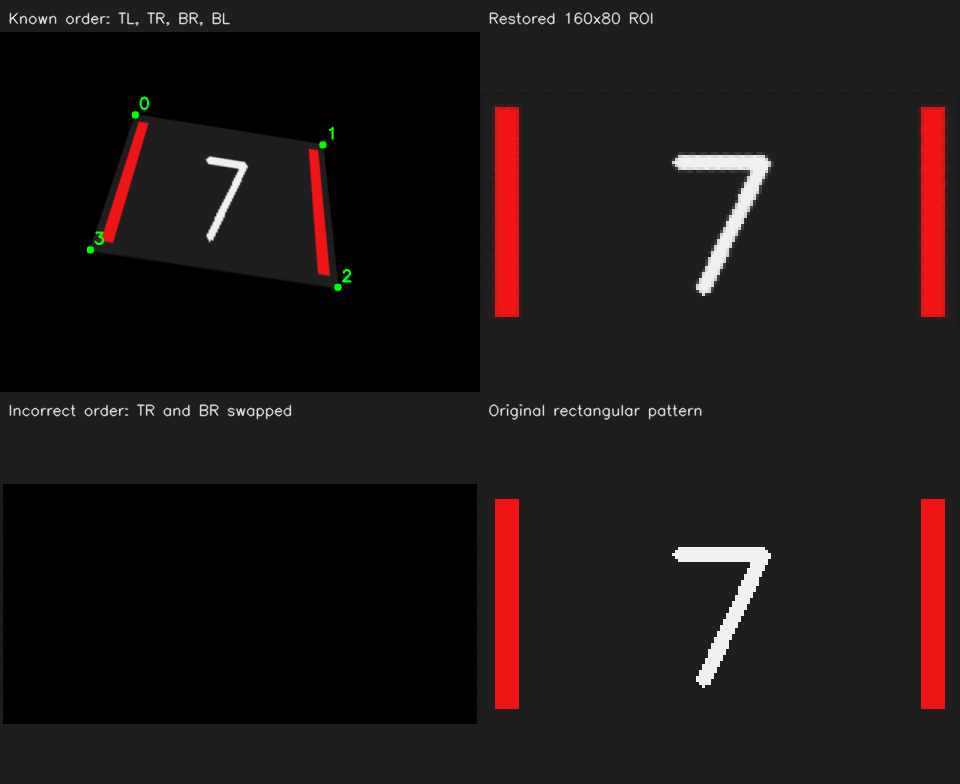

# OpenCV 10：透视裁剪与数字区域

从上一节的包围框继续往下做：找到倾斜的目标区域后，把它展开成固定大小的矩形，准备后续数字分类的输入。

## 实验记录

2026-10-31 打开 `10 Perspective ROI`，对照右下角原始矩形图案，观察右上的正确裁剪和左下的错误裁剪。我的反馈是：“右上还原，左下全黑。”

对照代码，两种裁剪读取同一张倾斜图像，区别在于四个角点的对应关系。正确结果把左上、右上、右下、左下依次对应到输出矩形的同名角点。错误结果只改了一处：交换源图右上和右下两个点。

```cpp
auto incorrect = quad;
std::swap(incorrect[1], incorrect[2]);
```

本例左上面板的角点编号和正确输出位置分别为：

| 编号 | 源图中的位置 | 输出矩形中的位置 |
| --- | --- | --- |
| 0 | 左上 | `(0, 0)` |
| 1 | 右上 | `(159, 0)` |
| 2 | 右下 | `(159, 79)` |
| 3 | 左下 | `(0, 79)` |

所以这次全黑结果来自错误的角点对应：输入目标相同，但错误映射没有采样出正确的目标图案。写透视变换时，需要明确每个源角点对应哪个目标角点。

本例输出宽 160、高 80，像素下标从 0 开始，所以右边界坐标为 159，下边界坐标为 79。固定像素尺寸便于统一后续输入；目标的实际距离仍需要另外解算。

## 运行

```bash
bash /home/rosdev/missing-semester/2027/Wit-1/self-study/opencv/10-perspective-roi/run.sh
```

四个面板分别显示倾斜目标、正确裁剪、角点对应错误的裁剪、生成时的原始矩形图案。源码：[src/main.cpp](src/main.cpp)。

<details>
<summary>透视变换、角点对应与插值接口备查</summary>

## ROI 裁剪与透视变换

普通 `image(rect)` 只能截取沿图像轴对齐的矩形。目标是斜四边形时，直接截取其包围框会带入背景，而且不会把倾斜区域展开。

这里给出四个源角点和四个目标角点：

```cpp
// 按左上、右上、右下、左下对应。
std::vector<cv::Point2f> destination = {
    {0, 0}, {159, 0}, {159, 79}, {0, 79}
};
auto H = cv::getPerspectiveTransform(source, destination);
cv::warpPerspective(image, roi, H, cv::Size(160, 80));
```

H 是图像平面之间的 3×3 透视变换矩阵。输出宽 160、高 80，边界像素坐标因此是 159 和 79。`Size` 先宽后高，与 `Mat` 构造时先行数后列数的习惯不同。

H 不等于目标到相机的三维旋转矩阵。把图“拉正”也不会自动得到实际距离。

## 角点对应是关键

源图的左上必须对应输出的左上，其余点也要按同一圈顺序对应。本例有意交换源图右上与右下，结果可能出现翻折、拉伸或空白，这与颜色阈值无关。

在前面的检测里，程序先把长轴统一朝上，再组合左条上端、右条上端、右条下端、左条下端。不能认为 `RotatedRect::points` 返回的四点天然就是任何姿态下的“左上、右上、右下、左下”。

## 插值与输出尺寸

普通彩色图的透视采样通常使用线性插值。二值 mask 或类别标签图若要保持离散值，应考虑最近邻插值。图像缩小可能丢细节，放大也不会补回原图不存在的信息。

固定 ROI 大小用于统一后续输入，但数字模型还可能要求裁掉灯条、转灰度、归一化、调整通道顺序。这些要求由模型定义，不能看到 160×80 就假定已经完成模型预处理。

## 实验结果与参考解释

正确裁剪应能看见朝向正常的“7”，与原始矩形相近；错误角点对应的结果明显异常。原图经两次插值后不会逐像素完全还原，所以正确裁剪的平均绝对误差也不必等于 0。

结果位于 `~/catkin_ws/records/opencv/offline-course/10-perspective-roi`。`metrics.json` 记录正确和错误裁剪的平均像素误差；本例应满足正确结果误差更小，尺寸为 160×80。

延伸理解：只知道数字区域的四边形，不会自动知道它的类别；识别属于后续模型推理阶段。

参考：[OpenCV 4.2 图像几何变换](https://docs.opencv.org/4.2.0/da/d6e/tutorial_py_geometric_transformations.html)。

</details>

## 程序结果图

右上是正确角点对应的结果，左下是交换右上与右下角点后的结果，右下为生成倾斜图像前的原始图案。


