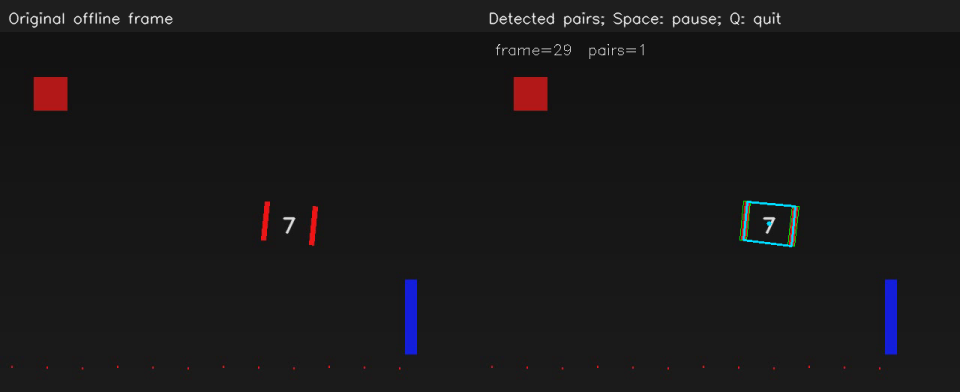

# OpenCV 11：离线视频、暂停与处理耗时

从静态图过渡到本地生成的视频。目标随帧平移、缩放并轻微旋转，中间还有一段遮挡；生成时的真实中心和深度保存在 `truth.csv`。

## 实验记录

2026-10-31 使用 `--value=60` 启动视频，在窗口按空格暂停，观察右侧 `frame=` 编号，等待几秒后再按空格继续。我确认：暂停期间帧编号停住，继续播放后接着递增。

结合代码看，程序每轮调用 `capture.read(frame)` 取下一帧，再进行检测和显示。暂停时停留在窗口按键等待循环，没有继续调用 `read`；现实时间仍在流逝，但当前数据帧没有前进。继续后再读取后续帧。

### 这一轮运行的时间记录

读取这次程序保存的 `metrics.json` 与 `frames.csv`，得到：

| 项目 | 本轮程序输出 | 含义 |
| --- | --- | --- |
| `source_fps` | 30 FPS | 视频文件标注的帧率 |
| 前三帧 `time_s` | 0、0.033333、0.066667 s | 视频内部时间，按帧编号除以 30 计算 |
| `mean_processing_ms` | 约 61.9 ms | 每帧处理段平均耗时，包含人工增加的 60 ms 等待 |
| `processing_capacity_fps` | 约 16.15 FPS | 用 1000 除以上述平均耗时得到的处理能力估计 |

视频数据相邻帧的时间间隔约为 33.3 ms，而这一轮每帧处理段平均需要约 61.9 ms，因此播放会变慢。视频文件的帧率和帧时间仍按原来的 30 FPS 计算。实际显示速度还受到解码、写视频和窗口显示等开销影响。

本例的暂停等待发生在处理段计时结束之后，因此暂停几秒不会计入这里的 `mean_processing_ms`。

### 遮挡时的配对与坐标

重新播放视频，观察中段一根灯条暂时消失时的结果。我看到 `pairs=0`，连接两根灯条的配对框也消失，没有停留在旧位置。

对照这次运行的 `frames.csv`：

| 帧编号 | 灯条数 | 配对数 | 本帧中心 `(u,v)` |
| --- | --- | --- | --- |
| 79，遮挡前 | 2 | 1 | `(350.5,212.5)` |
| 80，遮挡开始 | 1 | 0 | 留空 |
| 94，仍在遮挡 | 1 | 0 | 留空 |
| 95，遮挡结束 | 2 | 1 | `(304.5,208)` |

这次看到的配对框变化，与输出记录一致：少一根灯条时无法组成配对，本帧没有有效中心，程序便留空；重新检测到唯一配对后，再输出新一帧的坐标。这样每帧结果表达的都是本帧检测状态，旧中心不会被沿用为新观测。

这里用空字段和配对状态表达缺失。`(0,0)` 本身是合法像素坐标，不能仅凭两个坐标都为零来表示目标丢失。本节还没有加入运动预测，遮挡期间不输出预测位置。

## 运行与操作

```bash
bash /home/rosdev/missing-semester/2027/Wit-1/self-study/opencv/11-video-time/run.sh --value=60
```

空格暂停或继续，Q 退出。视频自然结束后停在最后一帧，按 Q 关闭。图像处理循环在 [src/main.cpp](src/main.cpp)。

<details>
<summary>逐帧读取、时间统计与输出文件备查</summary>

默认读取自带 `motion.avi`。如果 MJPG 视频编码不可用，程序会退回自带 PNG 序列，不需要下载其他素材。也可以用本地视频练习读取：

```bash
bash /home/rosdev/missing-semester/2027/Wit-1/self-study/opencv/11-video-time/run.sh --input=/容器内路径/example.mp4
```

这仍使用教学用颜色与几何条件，不保证任意视频都有检测结果。自行拍摄不是完成本节的前提。

## 从一张图变成循环

```cpp
cv::VideoCapture capture(path);
if (!capture.isOpened()) { /* 报告输入打不开 */ }
cv::Mat frame;
while (capture.read(frame)) {
    if (frame.empty()) break;
    auto detection = detect(frame, config);
    // 显示、保存或发布这一帧的结果。
}
```

`read` 成功才有新的一帧。读取结束后继续处理旧 frame，会造成“程序还在运行但画面或坐标没更新”的假象。循环内的 Mat 也可能被下一次读取复用，需要长期保存的图像应复制像素。

## 三种时间不要混在一起

| 数值 | 本例的含义 |
| --- | --- |
| 视频帧率 `source_fps` | 文件标注的播放频率，生成素材为 30 FPS |
| 数据时间 `time_s` | 帧编号除以帧率，是视频内部的相对时间 |
| `processing_ms` | 用单调时钟测得的一帧处理耗时 |

`1000 / 平均处理毫秒数` 是这段算法的处理能力估计，不等于实际相机帧率；还没有计入所有解码、显示和通信成本。`waitKey` 处理窗口事件，也可以等待，但不能把 `waitKey(30)` 直接当成可靠的 30 FPS 相机。

本例文件帧率缺失或异常时退回 30，结果里会标出 `fps_fallback`。PNG 序列的 30 FPS 来自素材生成设置。

## 人为制造变慢

```bash
bash /home/rosdev/missing-semester/2027/Wit-1/self-study/opencv/11-video-time/run.sh --value=60
```

这一节的 `value` 表示每帧额外等待多少毫秒。至少 60 ms 的处理时间意味着仅这部分就难以达到 30 帧/秒。观察播放变慢，但文件内部每帧的时间间隔并不会因此变成 60 ms。暂停时数据帧不前进，现实时间仍然流逝。

只验证并保存结果可使用：

```bash
bash /home/rosdev/missing-semester/2027/Wit-1/self-study/opencv/11-video-time/run.sh --headless --frames=30
```

## 保存与目标丢失

结果目录为 `~/catkin_ws/records/opencv/offline-course/11-video-time`：

| 文件 | 用途 |
| --- | --- |
| `frames.csv` | 逐帧灯条数、配对数、中心和耗时 |
| `annotated.avi` | 带检测框的视频；编码不可用时改存 `annotated-frames/` |
| `metrics.json` | 处理帧数、检测帧数、平均耗时等统计 |
| `overview.png` | 最后一帧面板 |

未找到唯一目标时，本帧中心留空，不复用上一帧结果；(0,0) 本身是有效像素坐标，不适合单独用来表示“未检测到”。本节尚未做运动预测或卡尔曼跟踪，因此遮挡后暂时没有结果是预期行为。

本节 `has_pose` 始终为 0，因为这里只做视频读取与检测。第 14 节才会在同一条处理流程中加入 PnP。

参考：[OpenCV 4.2 视频读写](https://docs.opencv.org/4.2.0/dd/d43/tutorial_py_video_display.html)。

</details>

## 程序结果图

示例视频的一帧及对应检测结果：


