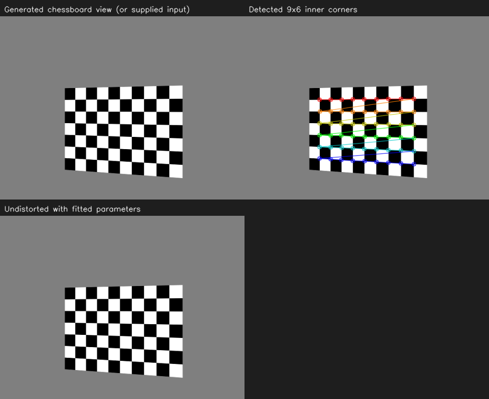
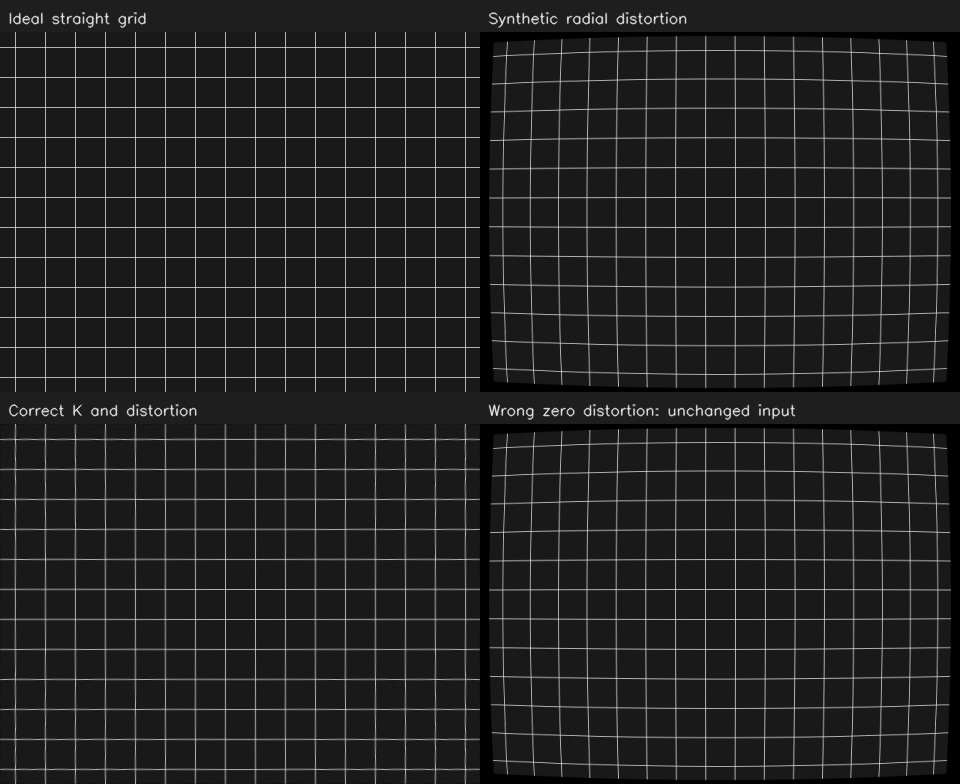

# OpenCV 12：棋盘格标定与畸变

从第 06 节给定相机参数的成像模型，进入通过棋盘格估计参数的流程。这里使用程序生成的不同姿态棋盘格，检测角点、细化位置，再拟合这套模拟相机的参数。

## 实验记录

2026-10-31 运行标定程序，在右上角角点检测图中观察彩色标记。我看到标记位于黑白方格的交汇处，沿同一条彩色连线数一排，有 9 个标记。

这里检测的是棋盘格的内角点。程序指定每排 9 个、共 6 排，即 54 个内角点，对应 10×7 个方格。`Size(9,6)` 填的是内角点数。

结合代码看，每个内角点都有棋盘格坐标系中的已知位置，方格边长为 0.025 m；检测结果则给出同一点在图像里的像素位置。标定把多幅图中这些一一对应的点交给 `calibrateCamera`，估计相机内参、畸变以及各幅图中棋盘格的姿态。窗口只展示其中一幅，程序实际使用了多幅不同姿态的图像。

### 本次拟合的参数

读取程序保存的 `metrics.json`，本次有 20 幅有效图像，重投影均方根误差约为 0.154 px：

| 参数 | 生成图像时的设置 | 本次拟合结果，约值 |
| --- | --- | --- |
| fx | 800 px | 800.03 px |
| fy | 800 px | 801.16 px |
| cx | 320 px | 318.27 px |
| cy | 240 px | 239.13 px |

fx、fy 是两个方向的像素焦距，cx、cy 是主点的像素坐标。它们组成第 06 节的内参矩阵 K。这里的拟合值接近生成时的设置；图像像素化、插值和角点定位会引入误差，因此不要求完全一致。

重投影误差的比较方式是：用拟合参数把棋盘格三维角点投回图像，再与检测到的像素位置比较。本次数据来自生成的棋盘格，这些结果描述的是模拟相机。

### 模拟畸变与校正的观察

接着运行 `--variant=distortion`，以左上理想网格为参照，观察到右上畸变图在边缘弯曲更明显；左下校正后的网格更接近原来的直线。

这组实验人为设置径向畸变：`k1=-0.25`、`k2=0.08`，其余系数为 0，使用已知的模拟内参生成图像。校正也使用这组已知参数，独立于前面棋盘格拟合输出的系数。

结合现象理解，径向畸变会改变像素相对主点的位置，本例在图像边缘的偏移更明显。校正使用内参和畸变模型重新采样，使弯曲网格更接近理想成像：

```cpp
cv::undistort(distorted, corrected, K, dist, K);
```

程序统计中间区域与理想图像的像素强度平均绝对差，校正前约 14.28，校正后约 6.59。这个数比较的是像素强度，不是角点位置的像素距离。图像经过两次重采样，校正结果也不要求逐像素完全等同于原图。

## 运行

```bash
bash /home/rosdev/missing-semester/2027/Wit-1/self-study/opencv/12-camera-calibration/run.sh
```

完成标定后按 Q 退出，再打开畸变对照：

```bash
bash /home/rosdev/missing-semester/2027/Wit-1/self-study/opencv/12-camera-calibration/run.sh --variant=distortion
```

源码：[src/main.cpp](src/main.cpp)。

<details>
<summary>标定、畸变与真实图片接入的接口备查</summary>

## 标定在求什么

第 06 节的 K 和畸变系数描述相机如何成像。标定利用“已知三维几何点”与“实际检测的二维像素点”之间的对应关系，估计这些参数，同时求出每幅图中标定板相对相机的姿态。

| 数据 | 本例内容 |
| --- | --- |
| `objectPoints` | 棋盘格内角点在板坐标系中的位置，Z=0，单位米 |
| `imagePoints` | 图像里检测出来的角点，单位像素 |
| 图像大小 | 640×480 |
| 棋盘格规格 | 每行 9 个、每列 6 个内角点，即 10×7 个方格 |
| 方格边长 | 0.025 m，属于生成素材的已知设置 |

9×6 数的是内角点，不是方格个数。`Size(9,6)` 的顺序也不能写反。

## 关键步骤

```cpp
bool found = cv::findChessboardCorners(gray, cv::Size(9, 6), corners);
if (found) {
    cv::cornerSubPix(gray, corners, cv::Size(5, 5), cv::Size(-1, -1), criteria);
    image_points.push_back(corners);
    object_points.push_back(board_points);
}
double rms = cv::calibrateCamera(object_points, image_points, image_size,
                                K, distortion, rvecs, tvecs);
```

角点细化给出亚像素位置，坐标出现小数很正常。同一相机的 K 通常在各幅图之间共享，而板的旋转和平移随拍摄姿态变化。重复同一个正面姿态无法提供足够丰富的几何约束，所以生成图中包含不同方向、位置与距离。

本例要求至少八幅有效图才继续，这只是程序入口限制，不是“八幅即可保证真实标定质量”的结论。

## 怎样看输出

目录：`~/catkin_ws/records/opencv/offline-course/12-camera-calibration`。

| 文件或值 | 含义 |
| --- | --- |
| `calibration.yaml` | K、畸变、分辨率、方格边长与数据来源标签 |
| `per-view.csv` | 每幅图的重投影 RMS，单位像素 |
| `metrics.json` | 有效图数、总体 RMS 和拟合的 fx、fy、cx、cy |

模拟输入的生成焦距为 800 px，主点为 (320,240)，镜头模型没有畸变。拟合结果应接近它们，但图像像素化、插值与角点检测会引入误差，不要求每个数字完全一致。

重投影误差是把拟合的三维板角点重新投到图像后，与检测角点比较得到的差值。误差小是一项检查，还要看姿态覆盖、分辨率、角点对应和模型是否合理。

输出的 `source` 为 `SYNTHETIC_CHESSBOARD_IMAGES`，表明参数来自合成棋盘格，仅用于本节模拟相机。

## 畸变实验

常见模型包含径向系数 k1、k2、k3，以及切向系数 p1、p2。先理解现象：直线在图像里弯曲，且边缘位置与理想针孔模型不同，不需要先背完整多项式。

第二组窗口显示理想网格、模拟径向畸变、使用正确参数校正的结果、错误地假设零畸变的结果。观察校正后网格更接近原图；两次重采样后仍会存在像素差值。该组输出保存到本节结果目录下的 `distortion/`，不覆盖前面的标定参数。

```cpp
cv::undistort(input, output, K, distortion, K);
```

实时逐帧校正可以预先计算 `initUndistortRectifyMap`，再对各帧 `remap`，避免每帧重复计算相同映射。本节默认通过一次性实验理解原理即可。

## 以后有真实图片时怎么接入

有一组同分辨率、规格一致的棋盘格图片后，可运行：

```bash
bash /home/rosdev/missing-semester/2027/Wit-1/self-study/opencv/12-camera-calibration/run.sh --input=/容器内的棋盘格图片文件夹 --square=0.025
```

本例的内角点数固定为 9×6；方格边长必须填实际测量值。不同规格需要改源码中的板尺寸。目录入口默认读取 PNG；图片路径也支持带引号的通配模式，例如 `--input='/path/*.jpg'`。

真实采集属于以后再做的可选实验：使用清晰平整的标定板，改变覆盖位置、倾角和距离，避免只拍一堆近乎相同的画面；测量方格尺寸。只有笔记本时，先完成本节模拟流程即可。

参考：[OpenCV 标定教程](https://docs.opencv.org/4.2.0/d4/d94/tutorial_camera_calibration.html)、[标定与畸变接口](https://docs.opencv.org/4.2.0/d9/d0c/group__calib3d.html)。

</details>

## 程序结果图

棋盘格角点检测与模拟标定，以及畸变实验的程序对照图：




