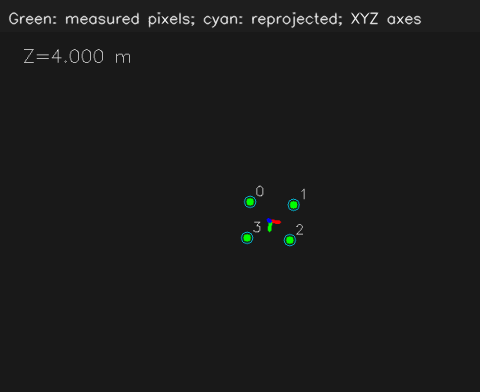

# OpenCV 13：PnP、误差与坐标变换

从图像中的四个点求目标相对相机的位置与朝向，再连接之前学过的坐标变换。输入由程序生成，生成时的位置与朝向已知，可以对照解算误差。

## 实验记录

2026-10-31 运行默认 PnP 实验，先保持 `Point noise px=0`，再调到 2，并按 S 保存当前结果。我读到的 Z 分别为 2 m 和 2.028 m。

| Point noise px | 窗口中的深度 Z | 操作 |
| --- | --- | --- |
| 0 | 2 m | 保持默认无噪声角点 |
| 2 | 2.028 m | 增加角点像素噪声后观察，并保存结果 |

这组实验使用生成角点时的已知模拟内参（fx=fy=800、cx=320、cy=240）与零畸变模型。目标模型尺寸和相机参数保持不变，变化来自输入图像角点的随机偏移。滑块控制高斯噪声的标准差，各个点的实际偏移量并不相同。

读取保存的 `metrics.json`，噪声为 2 时的结果为：

| 项目 | 本轮输出，约值 |
| --- | --- |
| 相机坐标 `(X,Y,Z)` | `(0.10079,0.03626,2.02864)` m |
| Z 相对生成值 2 m 的偏差 | 0.02864 m，约 2.86 cm |
| 三维位置误差 | 0.02933 m，约 2.93 cm |
| 重投影 RMS | 0.852 px |

这次看到，图像角点的像素级偏移会传到解算的位置与姿态中。厘米误差是本例尺寸、距离、姿态和噪声下的结果；换一组几何条件，误差大小也会变化。窗口显示的 Z 截取到有限位数，保存文件保留了更多精度。

### 把目标模型尺寸填成两倍

随后运行 `--variant=wrong-size`，保持 `Point noise px=0`。与最初无噪声基线相比，输入像素点和相机参数相同，只把求解使用的模型宽高同时写成两倍。我读到 Z 为 4.000 m。

| 对照项 | 正确尺寸的无噪声基线 | 宽高同时写成两倍 |
| --- | --- | --- |
| 模型宽 W | 0.15 m | 0.30 m |
| 模型高 H | 0.12 m | 0.24 m |
| 窗口中的 Z | 2 m | 4.000 m |

读取错误尺寸组保存的 `wrong-size/metrics.json`，解出的相机坐标约为 `(0.20,0.06,4.00)` m，重投影 RMS 记录为 0 px。目标生成时的位置仍是 `(0.10,0.03,2.00)` m，因此米制位置已经算错，但解出的模型仍能投影到输入像素点上。

继续在错误尺寸窗口对照绿色实心点和青色空心圈，我确认：Z 已经显示 4 m，青色重投影圈仍围在对应的绿色输入点周围。这也从画面上验证了日志中的低重投影误差。

结合成像关系理解，模型尺寸和目标位置同时按相同比例放大，投影到图像中的位置可以保持不变。这次把模型宽高写成两倍，求解出的平移也成为约两倍，正好体现了这个尺度关系。

因此重投影误差检查的是模型投影与输入像素是否吻合。它还需要与正确的物理尺寸、单位、相机参数和点对应关系一起使用，才能判断实际位置是否可信。

### 连接前面学过的坐标变换

回到正确尺寸、无噪声基线的程序输出，目标原点在相机坐标系中的位置约为 `(0.10,0.03,2.00)` m。本例的坐标轴约定是：

| 坐标系 | X 正方向 | Y 正方向 | Z 正方向 |
| --- | --- | --- | --- |
| 相机光学坐标 | 右 | 下 | 前 |
| 机器人坐标 | 前 | 左 | 上 |

程序给定的安装位置是相机原点位于机器人坐标 `(0.20,0,0.10)` m，轴向关系也已明确给定。对应计算为：

```text
X_body =  Z_camera + 0.20
Y_body = -X_camera
Z_body = -Y_camera + 0.10
```

因此正确基线的相机点 `(0.10,0.03,2.00)` m 转到机器人坐标后为 `(2.20,-0.10,0.07)` m，与已有基线检查记录一致。两组坐标描述同一个点，数值差异来自坐标轴方向和原点位置。

PnP 的 `tvec` 给出目标原点在相机坐标系中的位置，`rvec` 描述目标的旋转，可转换为旋转矩阵。这之后的相机到机器人变换，对应前面 ROS 学习中的 TF 安装关系；处理图像检测结果时，应使用该图像采集时刻对应的变换。

## 运行三组对照

默认模型：

```bash
bash /home/rosdev/missing-semester/2027/Wit-1/self-study/opencv/13-pnp-coordinates/run.sh
```

模型宽高同时填成两倍：

```bash
bash /home/rosdev/missing-semester/2027/Wit-1/self-study/opencv/13-pnp-coordinates/run.sh --variant=wrong-size
```

默认模型直接使用噪声为 2 的角点：

```bash
bash /home/rosdev/missing-semester/2027/Wit-1/self-study/opencv/13-pnp-coordinates/run.sh --value=2
```

前一组按 Q 退出后再开下一组。默认滑块 `Point noise px` 为 0，调到 1、2、3 会给图像点加入固定随机种子的像素噪声。源码：[src/main.cpp](src/main.cpp)。

<details>
<summary>PnP 输入输出、误差与坐标变换备查</summary>

## PnP 的四类输入

```cpp
cv::solvePnP(object_points, image_points, K, distortion,
             rvec, tvec, false, cv::SOLVEPNP_ITERATIVE);
```

| 输入 | 本例含义 |
| --- | --- |
| `object_points` | 物体坐标系下的四个三维点，米制 |
| `image_points` | 与这四个点逐个对应的图像像素 |
| `K` | 模拟相机内参 |
| `distortion` | 本例为零畸变模型 |

物体原点放在两根灯条围成区域的中心；本例中心线间距 W=0.15 m、条长 H=0.12 m。点按左上、右上、右下、左下排列：

```text
(-W/2, -H/2, 0)
( W/2, -H/2, 0)
( W/2,  H/2, 0)
(-W/2,  H/2, 0)
```

这些尺寸是课程素材设置，不代表真实比赛装甲板的尺寸。三维点定义在哪些物理位置，二维点就必须测对应的位置；不能把灯条外侧边缘与中心线间距混着用。

## rvec、tvec 的方向

输出满足：

```text
P_camera = R_camera_object * P_object + t_camera_object
```

因此 tvec 是物体原点在相机坐标系中的位置。物体点单位用米，tvec 也用米；若三维模型用毫米，输出就按毫米缩放。

rvec 是旋转向量，不是 roll、pitch、yaw 三个欧拉角。可用 `cv::Rodrigues(rvec, R)` 转成 3×3 旋转矩阵。反方向变换需要 `Rᵀ` 和 `-Rᵀ*t`，不能只把 t 改负号。

相机光学坐标为 X 向右、Y 向下、Z 向前。输出 Z 是深度，`norm(tvec)` 是到相机原点的直线距离，两者通常不同。

## 实验结果与参考解释

| 实验 | 已知设置与预期 |
| --- | --- |
| 默认无噪声 | 真实 t=(0.10,0.03,2.00) m，解应接近它 |
| 增加像素噪声 | 输入角点变化，姿态与深度也会变化；比较位置误差与重投影误差 |
| `wrong-size` | 把模型宽、高同时填成两倍，解出的距离也约为两倍，但重投影误差仍可接近 0 |

最后一组说明：低重投影误差不保证真实米制距离正确。相机参数、物理尺寸、像素点对应以及单位都属于输入的一部分。

平面目标还可能存在姿态歧义；通常需要结合正深度、几何合理性和连续帧判断。给四个点套上 RANSAC 也不能自动解决所有错误对应或尺寸错误。

## 去畸变后如何配参数

两种一致的常见流程：

1. 使用原始畸变图上的像素点，传入原始 K 和畸变系数。
2. 使用已经校正图像上的像素点，传入校正图所用的 K，并使用零畸变。

不能对同一组点重复补偿畸变。`undistortPoints` 默认输出的归一化坐标也不等于原始像素；若需要像素输出，要理解并设置它的投影矩阵参数。

## 从相机到机器人坐标

用一个明确给定的安装关系练习，不要求有真实底盘：

```text
机器人：X 前，Y 左，Z 上
光学系：X 右，Y 下，Z 前

R_body_camera = [ 0  0  1 ]
                [-1  0  0 ]
                [ 0 -1  0 ]
t_body_camera = (0.20, 0, 0.10) m

P_body = R_body_camera * P_camera + t_body_camera
```

相机点 (0.10,0.03,2.00) m 因此变成机器人点 (2.20,-0.10,0.07) m。这个转换应对应以后 TF 树中的安装关系，而不是临时随意交换几个数的正负号。

检测点属于哪一帧图像，就应使用对应采集时刻的 TF；这与之前学习的时间戳和 `lookupTransform` 相连。

结果位于 `~/catkin_ws/records/opencv/offline-course/13-pnp-coordinates`；错误尺寸组单独保存在其中的 `wrong-size/` 子目录。`metrics.json` 保存相机位置、深度、直线距离、重投影 RMS、相对生成答案的位置误差和机器人坐标。按 S 保存滑块改变后的当前结果。

参考：[OpenCV calib3d 接口](https://docs.opencv.org/4.2.0/d9/d0c/group__calib3d.html)、[ROS 图像光学坐标约定](https://github.com/ros/common_msgs/blob/noetic-devel/sensor_msgs/msg/Image.msg)。

</details>

## 程序结果图

无噪声与模型尺寸加倍两组实验的程序对照图：



