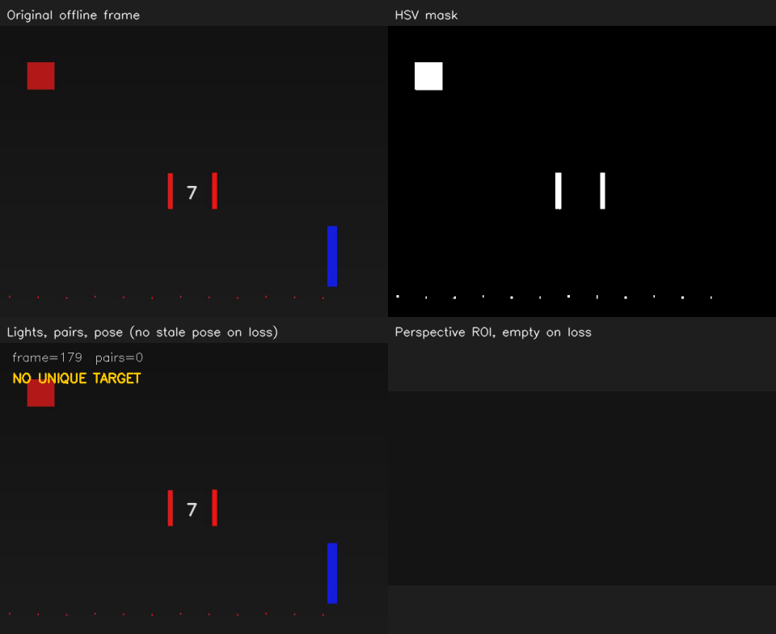
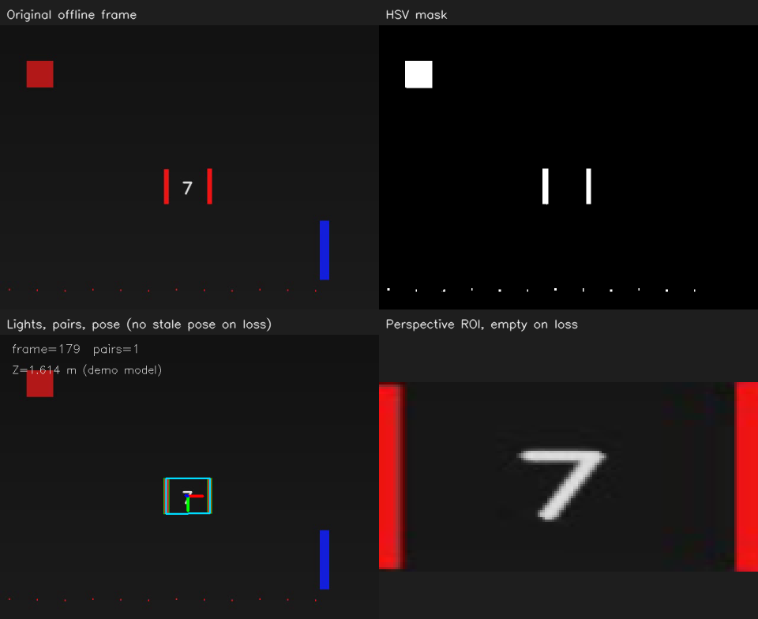

# OpenCV 14：完整离线视觉流程

把前面的颜色筛选、灯条配对、透视裁剪和 PnP 串到同一段离线视频中，逐帧观察检测、深度与数字区域的变化。素材、相机参数与目标尺寸来自同一套模拟设置。

## 实验记录

2026-10-31 使用默认检测配置，以 `--value=60` 放慢视频，观察到目标正常可见时左下角的 Z 随运动变化；中段一根灯条被遮挡时，右下角 ROI 变为空白，没有保留上一帧。

对照这轮程序保存的 `frames.csv`：

| 帧编号 | 配对数 | `has_pose` | 相机深度 Z，约值 |
| --- | --- | --- | --- |
| 0 | 1 | 1 | 1.638 m |
| 40 | 1 | 1 | 1.823 m |
| 80，遮挡开始 | 0 | 0 | 留空 |
| 94，仍在遮挡 | 0 | 0 | 留空 |
| 95，目标恢复 | 1 | 1 | 1.575 m |

这一轮把第 11 节的丢失状态延伸到了完整流程：每帧重新检测，得到唯一配对后才裁剪 ROI、求 PnP。缺少完整配对时，位置字段留空，显示区域用新建的深色图占位；因此不会把旧 ROI 或旧位姿当成本帧结果。这里画面上的“空白”是占位图，是否有有效位姿由 `has_pose` 表示。

### 提高面积门槛后的实际观察

随后使用 `14-min-area-900.yaml`，只把最小轮廓面积从 200 提高到 900。我观察到：右上 mask 中间的两根白色灯条仍在，右下方那根竖条不在 mask 中；左下不再出现配对框和 Z。

对照原图与生成代码，右下方竖条是蓝色干扰物，所以没有通过红色 HSV 条件。它被颜色筛选排除，与这次提高面积门槛是两件事。中间的红条通过颜色筛选，仍在 mask 中；它们对应的轮廓面积不足 900，随后在单根灯条筛选阶段被剔除。

这一轮 180 帧的输出记录中，通过单根筛选的灯条数、配对数和 `has_pose` 都为 0，Z 字段全部留空。问题发生在 PnP 之前：没有有效配对，就不会进入姿态解算。

这次把“颜色通过”和“最终检测通过”区分开了。查看流程时，可以沿 mask、单根候选、配对、PnP 逐层定位是哪一步没有通过，再检查对应参数。

下面保留这轮实际运行的概览图，中间红条在 HSV mask 中仍然清楚，但最终配对数为 0：



## 运行

```bash
bash /home/rosdev/missing-semester/2027/Wit-1/self-study/opencv/14-offline-pipeline/run.sh --value=60
```

空格暂停或继续，Q 退出。自然播放完会保留最后一帧。想只保存全部结果：

```bash
bash /home/rosdev/missing-semester/2027/Wit-1/self-study/opencv/14-offline-pipeline/run.sh --headless --frames=180
```

入口：[src/main.cpp](src/main.cpp)；逐帧循环复用 [第 11 节源码](../11-video-time/src/main.cpp)；颜色和候选提取位于 [detector.cpp](../_shared/src/detector.cpp)。

### 最小面积门槛的对照入口

[面积对照配置](config/detector-area-900.yaml) 保留在本节目录，由默认配置复制，只把 `min_area` 从 200 提高到 900。使用同一段视频和相同的颜色条件重做这组实验：

```bash
bash /home/rosdev/missing-semester/2027/Wit-1/self-study/opencv/14-offline-pipeline/run.sh --value=60 --config=/home/rosdev/missing-semester/2027/Wit-1/self-study/opencv/14-offline-pipeline/config/detector-area-900.yaml
```

从其他位置克隆仓库时，在本节目录执行 `bash run.sh --value=60 --config="$PWD/config/detector-area-900.yaml"`。去掉 `--config` 后重新运行，即恢复公共默认配置中的面积下限 200。

<details>
<summary>流程、配置、输出与评价方法备查</summary>

## 数据怎样流动

```text
离线视频帧 BGR
  → HSV 红色 mask
  → 外轮廓
  → 面积、细长程度、方向筛选
  → 两根灯条的长度、位置、方向差检查
  → 唯一候选的四个端点
  → 透视 ROI 与 PnP
  → 标注图、逐帧状态、位置与耗时
```

四个面板显示原图、颜色 mask、检测和姿态结果、拉正的 ROI。先定位哪个阶段开始偏离预期，再看该阶段的参数，避免只看最终框的数量。

## 本例约定

模拟相机为 640×480、fx=fy=800、主点 (320,240)、零畸变。物理模型的灯条中心线间距 0.15 m、条长 0.12 m。它们是生成视频的参数，因此可以与解算结果比较。

第 80～94 帧有意遮挡一根灯条。这一段应该没有完整配对，不应该继续发布上一帧的位姿。这里只做检测和解算，不用卡尔曼预测遮挡期间的位置。

程序仅在恰好一个候选配对时求 PnP；若没有候选或有多个候选，不随意选择一个作为确定目标。这也意味着完整系统还会需要目标选择和跨帧关联策略。

## 参数实验

默认配置在 [detector.yaml](../_shared/config/detector.yaml)。只改配置不需要重新编译 C++，但程序是在启动时读取，因此改完应重启该例子。

建议先复制一份作实验：

```bash
cp ../_shared/config/detector.yaml ~/catkin_ws/records/opencv/detector-experiment.yaml
bash run.sh --config=/home/rosdev/catkin_ws/records/opencv/detector-experiment.yaml
```

编辑复制出的 YAML，不要一开始就同时改多个数。

| 改动 | 观察与参考解释 |
| --- | --- |
| `min_area` 从 200 提高到 900 | 本轮灯条全部无法通过，mask 中仍有红色像素；颜色通过不等于几何通过 |
| `max_tilt` 降得很小 | 轻微旋转也可能使单根条被排除 |
| `saturation_min` 设为 0 | 白灰区域可能进入颜色 mask，最终是否形成配对还取决于几何条件 |
| 恢复默认参数 | 回到可比较的基线，再测试下一个条件 |

对一张图调得很好，不代表对不同距离、曝光、运动模糊和遮挡都有效。这里先用明确的合成变化验证处理链；以后接真实图片时再逐项检查。

## 输出与评价

结果目录为 `~/catkin_ws/records/opencv/offline-course/14-offline-pipeline`，包含 `frames.csv`、标注视频或 PNG 序列、最后一帧概览和统计。

`frames.csv` 中的中心是像素坐标，x/y/z_m 是相机坐标米制位置，`has_pose` 表示本帧有没有有效姿态。未检测到时位置留空，不能把“没有数据”读成数值 0。

生成素材的真实答案位于 `../assets/truth.csv`，相对于本节结果目录而言。可以逐帧比较：

```text
中心误差 = sqrt((u_detect-u_true)^2 + (v_detect-v_true)^2)
深度绝对误差 = abs(Z_detect-Z_true)
```

批量检查还判断可见段是否检测到足够多的帧、遮挡段是否停止输出姿态。程序输出的检测耗时是算法段耗时，不等于机器人端到端控制延迟。

这些数值评估的是生成素材上的流程正确性。真实工程还要用真实标注数据评价误检、漏检、目标选择、距离误差和时延，不能把模拟数据上的检查成绩当作赛场效果。

## 与后续识别的连接

这条流程串联了颜色、几何、四点对应与空间解算。数字“7”尚未被模型分类识别，ROI 为下一阶段准备输入。

本例使用已知模拟相机，未提供任意真实视频的通用测距入口。普通本地视频读取可在第 11 节完成；真实测距还需把对应内参、畸变、尺寸和图像点定义接入代码。

</details>

## 程序结果图

四个面板分别展示原始帧、HSV mask、检测与 PnP 结果，以及拉正的 ROI：


