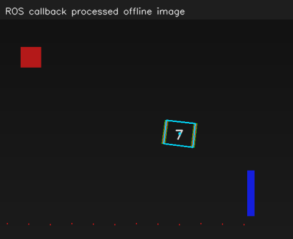

# OpenCV 15：ROS 1 图像消息与 cv_bridge

把 OpenCV 检测接到 ROS 1 Noetic 的发布、订阅与回调中。用生成的 PNG 序列模拟相机，观察图像怎样成为消息、进入回调，再交给检测算法处理。

## 实验记录

2026-10-31 使用默认检测配置启动本节，观察到终端的 `received=` 数字持续增加，窗口中能看到配对框。

对照这轮运行日志，连续几次打印的接收计数为 `2220 → 2240 → 2260`，图像尺寸为 `640×480`，`frame` 为 `camera_optical_frame`。源码中发布器按 20 Hz 发送图像，日志用 `ROS_INFO_THROTTLE(1.0, ...)` 限频；因此约一秒打印一次，但这一秒内已经接收并处理了多张图像。

结合代码看，处理节点订阅 `/vision_course/image_raw`，每次收到图像后进入回调，再转换为 OpenCV 可用的 Mat：

```cpp
const auto shared = cv_bridge::toCvShare(message, sensor_msgs::image_encodings::BGR8);
const auto detection = lab::detect(shared->image, config);
```

这次窗口中的配对框来自回调里执行的检测。窗口由处理节点直接显示标注图；处理后的图像还会发布到 `/vision_course/image_debug`，已通过无窗口检查中的额外订阅者核对这条输出话题。

这与前面海龟的发布订阅相连：海龟实验传速度或位置消息，这里传 `sensor_msgs/Image`。消息中包含像素数据及其尺寸、编码和时间信息，`cv_bridge` 负责连接 ROS 图像消息与 `cv::Mat`。

### 用额外订阅者接收输出图像

退出交互窗口后，运行本节的 `--headless` 检查。处理节点接收并处理了 30 张图像，额外的检查订阅者实际收到了 `/vision_course/image_debug` 的一张输出图像，终端显示 `ROS IMAGE CHECK PASSED`。

读取这轮 `output-message.json` 和 `metrics.json`，得到：

| 字段或检查项 | 本轮实际结果 | 结合实验理解 |
| --- | --- | --- |
| 图像宽高 | 640×480 | 接收者知道怎样排列像素 |
| `encoding` | `bgr8` | B、G、R 三通道，每通道 8 位 |
| 像素数据字节数 | 921600 | 等于 640×480×3，传输的是实际图像像素 |
| `frame_id` | `camera_optical_frame` | 图像对应的光学坐标系名称 |
| `stamp_preserved` | 1 | 处理后保留输入图像时间戳 |
| `frame_preserved` | 1 | 处理后保留输入坐标系标识 |
| `encoding_bgr8` | 1 | 输出编码符合本例的 BGR 格式 |

检查订阅者还核对了每行字节跨度 `step=1920`，以及数据总长度与步长、图像高度的一致性。因此这次确认的是完整像素消息能被另一节点正确接收。

画框使用的标注图来自输入图像的 clone，联系第 07 节的独立拷贝；发布输出时沿用输入 header，联系前面 TF 按图像时刻查询变换的要求。处理花费了一段时间，图像记录的仍是原来的场景时刻，所以画框后保留它的时间戳。本例发布器用当前时间模拟采集时间。

`frame_id` 提供坐标系名称，具体安装变换仍由 TF 树描述。消息里的编码、步长、像素和时间各有作用，接收方需要按这些信息解释图像。

下面保留本轮通信检查保存的处理结果：



## 运行

```bash
bash /home/rosdev/missing-semester/2027/Wit-1/self-study/opencv/15-ros-image/run.sh
```

脚本在课程专用端口 11341 启动 master，再启动离线图像发布进程与处理进程。窗口按 Q 退出后，脚本清理它自己启动的进程。若端口已被占用，可换一个课程端口，不必停止其他 ROS 系统：

```bash
OPENCV_COURSE_ROS_PORT=11342 bash /home/rosdev/missing-semester/2027/Wit-1/self-study/opencv/15-ros-image/run.sh
```

只做通信检查、不显示窗口：

```bash
bash /home/rosdev/missing-semester/2027/Wit-1/self-study/opencv/15-ros-image/run.sh --headless
```

源码：[src/main.cpp](src/main.cpp)；自动启动与清理逻辑位于 [ros-run.sh](../_shared/ros-run.sh)。

<details>
<summary>图像消息字段、cv_bridge 与通信检查备查</summary>

## 两个节点与两条话题

```text
离线图像发布节点
  ── /vision_course/image_raw：sensor_msgs/Image ──→ 处理节点
处理节点
  ── /vision_course/image_debug：sensor_msgs/Image ──→ 显示或检查订阅者
```

发布者按 20 Hz 从序列读取并循环发布。这里使用的模拟发布频率与素材标注的 30 FPS 不同，两者不是自动绑定的。

ROS 消息不只是图像文件名；它包含实际像素字节及其解释方式。常用字段：

| 字段 | 意义 |
| --- | --- |
| `header.stamp` | 图像对应的时间 |
| `header.frame_id` | 对应相机光学坐标系名称 |
| `width`、`height` | 宽高 |
| `encoding` | 通道意义、排列与数值格式，例如 bgr8、rgb8、mono8 |
| `step` | 一整行数据的字节跨度 |
| `data` | 像素字节 |

frame_id 是坐标系标识，不会仅凭这串名字自动建立 TF 关系。

## 发布图像

```cpp
std_msgs::Header header;
header.stamp = ros::Time::now();
header.frame_id = "camera_optical_frame";
publisher.publish(cv_bridge::CvImage(header, "bgr8", frame).toImageMsg());
```

本节没有硬件采集时刻，使用发布器当前时间模拟采集时间。真正的相机驱动应提供图像采集时间，处理节点不要把它改成“处理完成的现在”。之前学习 TF 时按采集时刻查询变换，依赖的就是这项信息。

## 订阅回调与共享图像

```cpp
auto shared = cv_bridge::toCvShare(message, "bgr8");
cv::Mat debug = shared->image.clone();
// 在 debug 上画框，不修改 shared->image。
auto output = cv_bridge::CvImage(message->header, "bgr8", debug).toImageMsg();
```

`toCvShare` 在条件允许时共享数据，适合只读访问；`toCvCopy` 提供可修改的副本，也可能执行编码转换。共享结果依赖消息的生命周期，需要跨回调长期持有像素时要明确保存所有权或复制。

第 07 节的 Mat/clone 在这里直接用上：算法读取输入图，在自己的副本上绘制标记。处理输出沿用输入 header，所以时间戳和坐标系不会因画框而改变。

输入 encoding 写错会导致颜色、类型或步长解释错误。OpenCV 普通彩色 Mat 按 BGR 使用时，发布声明也应与像素实际排列一致。

## 队列与积压

本例订阅队列长度为 1，便于演示优先处理近期图像。它不保证每帧都处理，也不自动解决慢回调问题；若检测比输入慢，应测耗时、减少处理或调整线程与缓存策略。

学习时先保持单线程回调和清晰的输入输出，不必先写复杂的多线程框架。目标跟踪所需的时间差应来自数据时间，而不是仅数回调执行了多少次。

## 检查结果

输出位于 `~/catkin_ws/records/opencv/offline-course/15-ros-image`。headless 检查会处理至少 30 张图，并由额外订阅者实际接收 debug 话题，检查尺寸、bgr8 编码、时间和数据字节数。

`metrics.json` 中 `stamp_preserved`、`frame_preserved`、`encoding_bgr8` 应为 1。`output-message.json` 记录检查订阅者收到的元信息。master 和发布者的日志也在同一结果目录。

如果在另一个已进入容器的终端使用 rostopic，需要先把它连接到同一个课程 master：

```bash
export ROS_MASTER_URI=http://127.0.0.1:11341
rostopic info /vision_course/image_raw
rostopic hz /vision_course/image_raw
```

课程正在运行时才有对应发布者。脚本退出后该课程 master 也随之结束；之后的新练习按自己的环境连接 master。

参考：[ROS 1 Image 消息定义](https://github.com/ros/common_msgs/blob/noetic-devel/sensor_msgs/msg/Image.msg)、[Noetic cv_bridge 接口](https://github.com/ros-perception/vision_opencv/blob/noetic/cv_bridge/include/cv_bridge/cv_bridge.h)。

</details>
