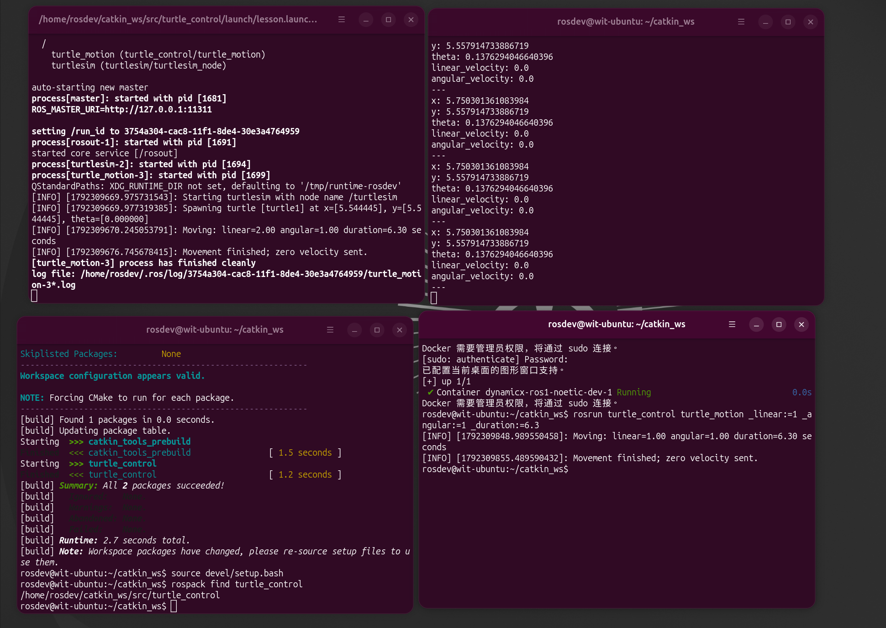

# 02：终端、节点、话题和回调

## 学了什么

我一开始把终端、节点、话题的关系混在一起。现在按下面的分工理解：

| 名称 | 实际是什么 |
| --- | --- |
| 终端 | 输入命令、显示输出的窗口 |
| 节点 | 运行中的 ROS 程序 |
| 话题 topic | 节点通过名称约定的消息通道 |
| 消息类型 | 数据结构，例如 `geometry_msgs/Twist`、`turtlesim/Pose` |
| 一条消息 | 某一次实际发送的数据 |

本次主要有两条数据流：

```text
控制节点 → /turtle1/cmd_vel → 海龟节点
海龟节点 → /turtle1/pose → 位置接收节点
```

话题名称写在程序的发布、订阅声明中。比如控制代码声明：

```cpp
auto publisher = nh.advertise<geometry_msgs::Twist>("turtle1/cmd_vel", 1);
```

在当前默认命名空间下，这个名称对应 `/turtle1/cmd_vel`。官方海龟代码订阅它，接收速度指令；同时发布 `/turtle1/pose` 状态消息。

## 做过的实验

### 发布速度：直行、原地转弯、画圆

先在一个开发终端启动海龟，保留该终端运行：

```bash
roslaunch turtle_control lesson.launch
```

初次运动结束后，海龟窗口仍在。另一个终端可以只重跑控制节点：

```bash
rosservice call /reset
rosrun turtle_control turtle_motion _linear:=1 _angular:=0 _duration:=3
```

把 `linear` 改为 0、`angular` 改为 1，会原地转弯；二者都为 1，会边走边转，形成圆弧。可用 `_duration:=6.3` 观察接近一圈的轨迹。

| 字段 | 含义 |
| --- | --- |
| `command.linear.x` | 在海龟程序中表示沿自身前方的速度，正数前进，负数后退 |
| `command.angular.z` | 转弯角速度，单位弧度/秒，正数逆时针 |

填好消息只是改内存中的数据，`publisher.publish(command)` 才会发送。示例约每秒发布 20 次，运动时间结束时主动发布零速度。

我在问答中判断：角速度不变，前进速度增大，圆的半径会变大。正向前进时，半径为 `v / |ω|`。本次从 `v=1, ω=1` 改为 `v=2, ω=1`，半径翻倍，转一圈所需时间仍约为 `2π / |ω|`。

### 接收位置与理解回调

先用命令行工具看位置：

```bash
rostopic echo /turtle1/pose
```

再按 Ctrl+C 停止查看，换成自己的接收程序：

```bash
rosrun turtle_control turtle_pose_listener
```

关键代码是：

```cpp
auto subscriber = nh.subscribe("turtle1/pose", 10, poseCallback);
ros::spin();
```

`subscribe` 登记话题和回调函数，`10` 是接收队列容量，不是每秒接收次数。`ros::spin()` 持续处理回调。收到消息时，ROS 调用登记的 `poseCallback`，其中的 `message->x`、`message->y`、`message->theta` 就来自这次位置消息。

回调会处理收到的消息；为了便于阅读，程序的日志限制为每秒最多打印一次。海龟停着时也会继续发布位置，我在问答中确认：回调由“收到消息”触发，不是由“海龟移动”触发。

## 观察与解释

### 四个终端分别在做什么

这是学习时的实际窗口截图：



| 当时的位置 | 任务 | 运行状态与作用 |
| --- | --- | --- |
| 左下 | 创建、编译和查询软件包 | 命令已结束、正在等待输入；不负责中转消息 |
| 左上 | `roslaunch` | 控制节点完成后，海龟节点和自动启动的 ROS master 仍在运行 |
| 右下 | `rosrun` 控制 | 一次运动结束后回到提示符，可以继续输入下一条命令 |
| 右上 | 接收位置 | 持续接收状态并打印；停止查看不影响海龟继续发布 |

如果 ROS master 由这次 roslaunch 自动启动，结束整个 launch 通常也会结束其管理的 master 和节点。因此保留海龟时，保留启动它的 roslaunch；只重跑运动程序用 rosrun。

ROS master 帮助节点登记和找到彼此。普通话题连接建立后，消息在相关节点之间传输，编译终端和 master 都不是这些消息的中转窗口。

### 查询真实连接

```bash
rostopic info /turtle1/pose
```

某次实际查询得到：消息类型为 `turtlesim/Pose`，发布者是 `/turtlesim`，订阅者是 `/turtle_pose_listener`。

`Publishers` 和 `Subscribers` 反映当前登记的连接关系，不是目录里有哪些 `.cpp` 文件。控制节点完成并退出后，会从相应的运行列表中消失。括号里的 `http://127.0.0.1:端口/` 是节点联系地址，端口不是需要手动创建的文件夹。
