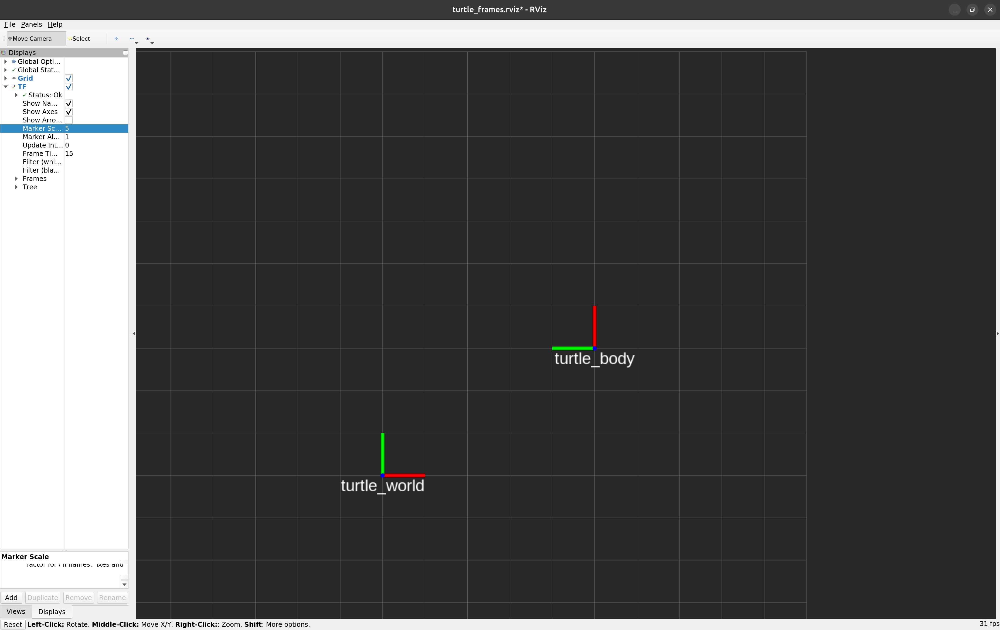

# 08：RViz 显示与视角操作

## 学了什么

RViz 订阅 ROS 数据并绘图。本次用它显示 TF 坐标系、网格和机器人模型；海龟的位置和运动仍由 turtlesim 模拟器产生。

| 内容 | 作用 |
| --- | --- |
| Fixed Frame | 显示数据时使用的固定参考坐标系，本例为 `turtle_world` |
| Grid | 显示网格，方便观察位置和距离 |
| TF | 显示坐标轴、坐标系名称和关系树 |
| RobotModel | 根据 URDF 和 TF 显示机器人部件 |
| Views | 设置观察视角、位置和缩放 |

坐标轴的颜色为 x 红、y 绿、z 蓝。改变视角或标记大小只影响显示。

## 做过的实验：显示世界与海龟坐标系

保持 `lesson.launch` 和 `dynamic_frames.launch` 运行，在容器开发终端执行：

```bash
rosrun rviz rviz -d "$(rospack find turtle_control)/rviz/turtle_frames.rviz"
```

`-d` 加载显示配置。若出现 ROS 1 Noetic 维护期结束的提示，点击 OK 后继续启动，本次开发环境保持 ROS 1 Noetic。

本次已显示 `turtle_world` 和 `turtle_body`，TF 状态为 Ok。海龟位于世界 `(5, 3)`、面向上时：

- 世界坐标系的红色 x 轴向右、绿色 y 轴向上。
- 海龟自身坐标系的红色 x 轴向上、绿色 y 轴向左。
- 海龟原点在世界坐标系中向右 5 格、向上 3 格的位置。



随后沿海龟自身前方运动：

```bash
rosrun turtle_control turtle_motion _linear:=1 _angular:=0 _duration:=2
```

已观察到自身坐标系随海龟向世界正 y 方向移动，原点从 `(5, 3)` 到约 `(5, 5)`；自身朝向不变，世界坐标系保持固定。

## 基本操作

先选中顶部的 Move Camera 工具，再在绘图区操作：

| 操作 | 鼠标方式 |
| --- | --- |
| 平移视野 | 按住中键，也就是按下滚轮后拖动 |
| 旋转视角 | 按住左键拖动 |
| 放大、缩小 | 滚动滚轮，或按住右键拖动 |

`TopDownOrtho` 是俯视模式，左键拖动会旋转平面视图。恢复正向俯视，可以在 Current View 中将 Angle 设为 0；修改 X、Y 可以调整视野位置。

`Orbit` 是三维观察模式，左键拖动会绕观察中心旋转。可通过滚轮调整观察距离，或在 Current View 中查看 Distance、Yaw、Pitch 和 Focal Point。

### 调整坐标轴和名称

展开 TF，调整 Marker Scale 可以改变坐标轴及名称的显示大小。本次在俯视图中将它调为 5，使标记更清楚。名称重叠时，可以取消 Show Names；取消整个 TF 的勾选可暂时隐藏坐标轴，RobotModel 可以单独显示模型。

这些操作不会改变机器人坐标或相机安装参数。

### 保存显示配置

窗口标题中的 `*` 表示显示配置有未保存的修改。可以按 Ctrl+S，或关闭窗口时选择 Save，将当前视角、显示项和标记大小等保存到 `.rviz` 文件。

`turtle_frames.rviz` 用于坐标轴练习，`turtle_model.rviz` 用于底盘与相机模型。模型的结构见 [URDF 笔记](09-urdf-tf-tree.md)。
