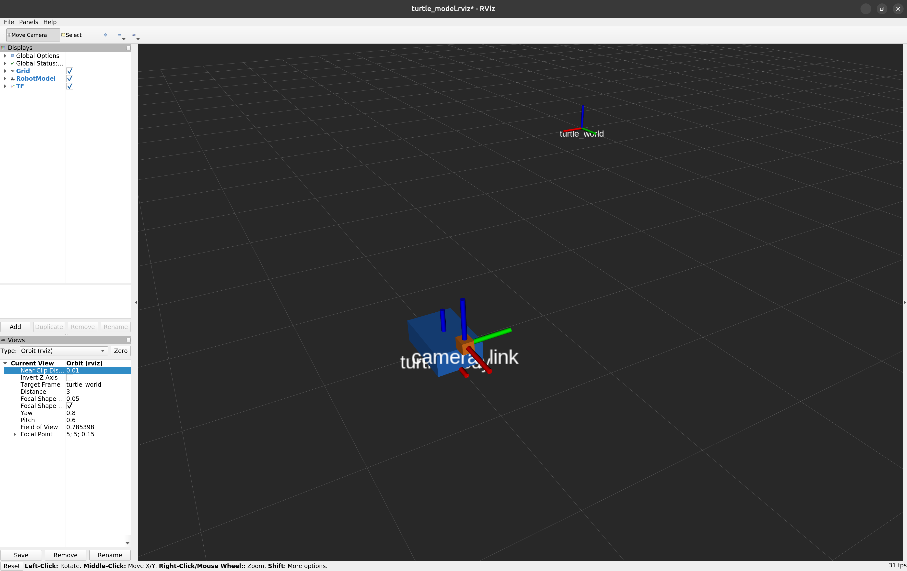

# 09：URDF、固定关节与 TF 坐标树

## 学了什么

URDF 用 XML 描述机器人部件和连接关系。本次模型由底盘和固定安装的相机组成。

| 内容 | 本例中的含义 |
| --- | --- |
| `link` | 一个刚体部件，分别为 `turtle_body` 和 `camera_link` |
| `joint` | 两个部件之间的连接，本例为 `camera_mount` |
| `parent`、`child` | 连接中的父部件和子部件 |
| `origin` | 关节定义中，子坐标系相对于父坐标系的位姿 |
| `fixed` | 两个部件的相对位姿固定 |

相关文件为 [turtle_camera.urdf](turtle_control/urdf/turtle_camera.urdf)、[robot_model.launch](turtle_control/launch/robot_model.launch) 和 [turtle_model.rviz](turtle_control/rviz/turtle_model.rviz)。

## 做过的实验：显示底盘和相机

保持 `lesson.launch`、`dynamic_frames.launch` 运行，关闭前一个坐标轴练习的 RViz 窗口，在容器开发终端执行：

```bash
roslaunch turtle_control robot_model.launch
```

已正常显示蓝色长方体底盘和橙色相机。图中的红绿蓝线是 TF 坐标轴。



启动过程的分工是：

| 内容 | 作用 |
| --- | --- |
| URDF | 描述部件外形和连接关系 |
| `robot_description` 参数 | 保存启动文件加载的 URDF 内容 |
| `robot_state_publisher` 节点 | 根据模型发布部件之间的 TF |
| 海龟位置广播节点 | 提供世界到整个底盘的动态 TF |
| RViz | 结合模型描述和 TF 绘制部件 |

本例 URDF 的根部件是 `turtle_body`，它在世界中的位置由已有海龟节点及动态 TF 广播程序提供。

## 固定安装关系

相机连接的定义是：

```xml
<joint name="camera_mount" type="fixed">
  <parent link="turtle_body"/>
  <child link="camera_link"/>
  <origin xyz="0.4 0 0.3" rpy="0 0 0"/>
</joint>
```

相机坐标系原点在底盘坐标系中的位置为：沿自身 x 向前 0.4 m、y 偏移为 0、沿 z 向上 0.3 m；相机与底盘坐标轴方向一致。这是教学模型给定的安装参数，实际机器人要根据测量或标定填写。

在一个开发终端查看固定关系：

```bash
rosrun tf tf_echo turtle_body camera_link
```

模型对应的平移为 `[0.4, 0, 0.3]`，RPY 为 `[0, 0, 0]`。让海龟原地转动：

```bash
rosrun turtle_control turtle_motion _linear:=0 _angular:=1 _duration:=1.57
```

固定的是相机与底盘之间的相对关系。底盘运动时，相机跟着运动；相机在世界中的位姿会改变。

### 静态关系查询时显示时间 0

查询 `turtle_body → camera_link` 时出现 `At time 0.000`。本例通过 `/tf_static` 发布固定关系，对任意查询时刻都适用；使用最新时间查询纯静态关系时，显示 0 是正常的。

`tf_echo` 默认仍应每秒打印一组。持续重复相同数值与终端完全没有新输出是两种情况。若误按 Ctrl+S 暂停了终端输出，可以按 Ctrl+Q 恢复。

## 做过的实验：沿 TF 树组合变换

现在有一条连通的关系：

```text
turtle_world ──动态 TF──→ turtle_body ──固定 TF──→ camera_link
```

TF 可以沿路径组合变换。在对应时间的关系可用时，查询相机在世界中的位姿：

```bash
rosrun tf tf_echo turtle_world camera_link
```

保持查看终端运行，在空闲终端中分别设置两个位姿，每执行一条就观察输出：

```bash
rosservice call /turtle1/teleport_absolute "{x: 5.0, y: 5.0, theta: 0.0}"
rosservice call /turtle1/teleport_absolute "{x: 5.0, y: 5.0, theta: 1.5708}"
```

已核对两次结果与下表一致：

| 底盘位姿 | 相机在世界中的 Translation |
| --- | --- |
| 位于 `(5, 5)`，面向右 | `[5.400, 5.000, 0.300]` |
| 位于 `(5, 5)`，面向上 | `[5.000, 5.400, 0.300]` |

相机的前方偏移沿底盘自身 x 轴。底盘朝向变化后，这段偏移在世界中的方向也发生变化；相对底盘的安装关系保持不变。

视觉程序将目标从相机坐标系转换到机器人或世界坐标系时，同样需要正确的安装关系，以及与数据采集时刻匹配的 TF。

## 参考资料

- [robot_state_publisher 发布关节变换](https://github.com/ros/robot_state_publisher/blob/noetic-devel/src/robot_state_publisher.cpp)
- [TF 静态缓存的时间处理](https://github.com/ros/geometry2/blob/noetic-devel/tf2/src/static_cache.cpp)
- [tf_echo 查看工具](https://github.com/ros/geometry/blob/noetic-devel/tf/src/tf_echo.cpp)
